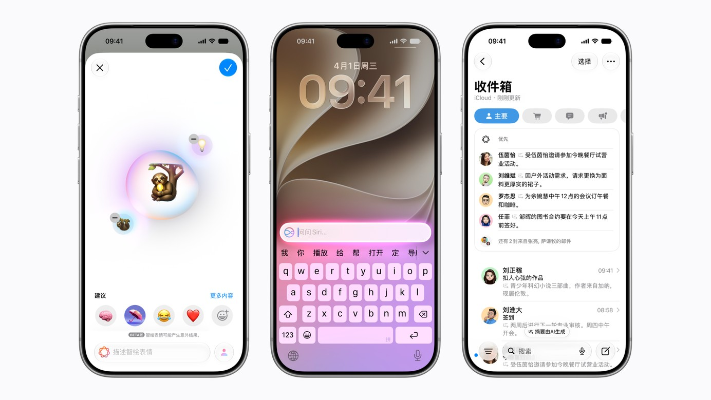
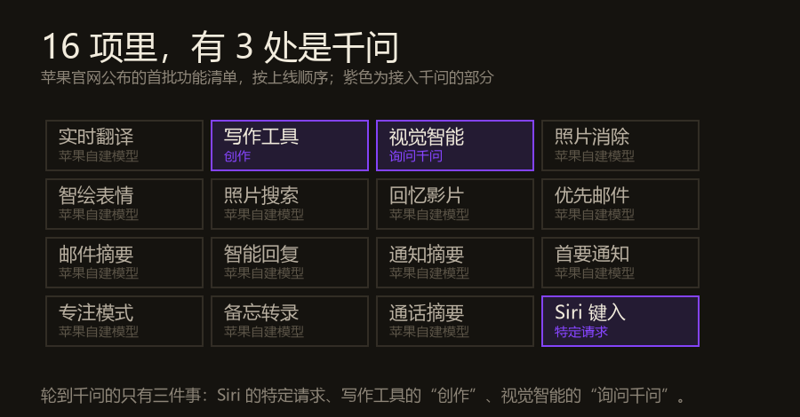
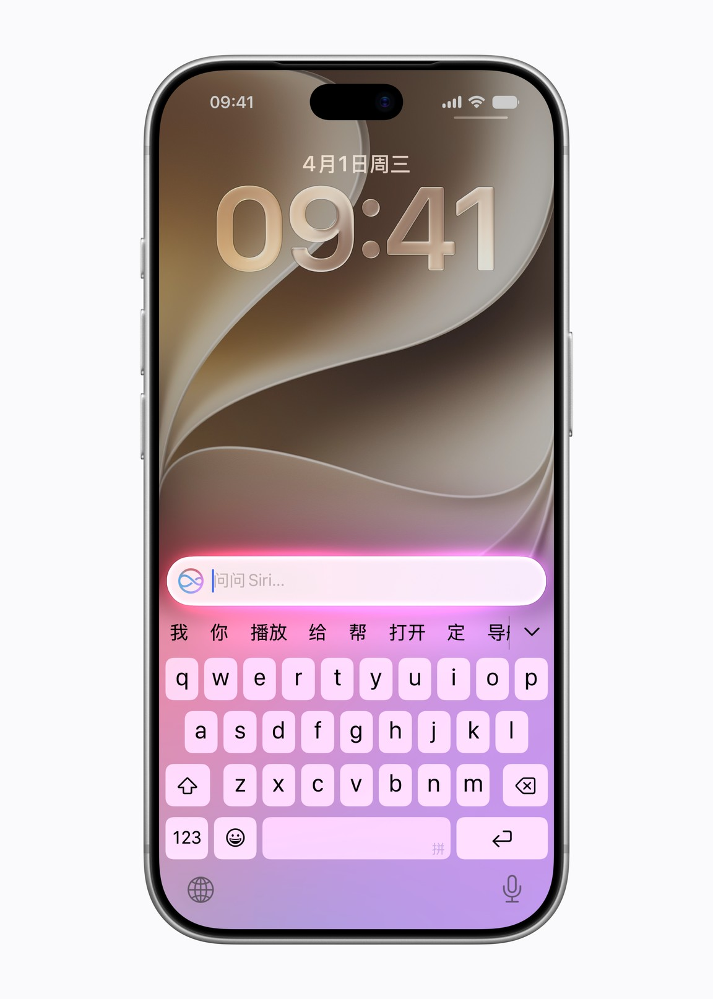
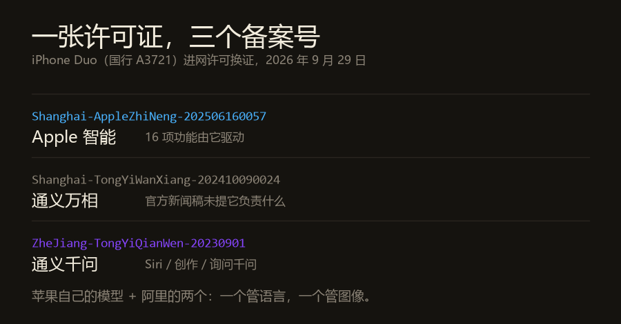
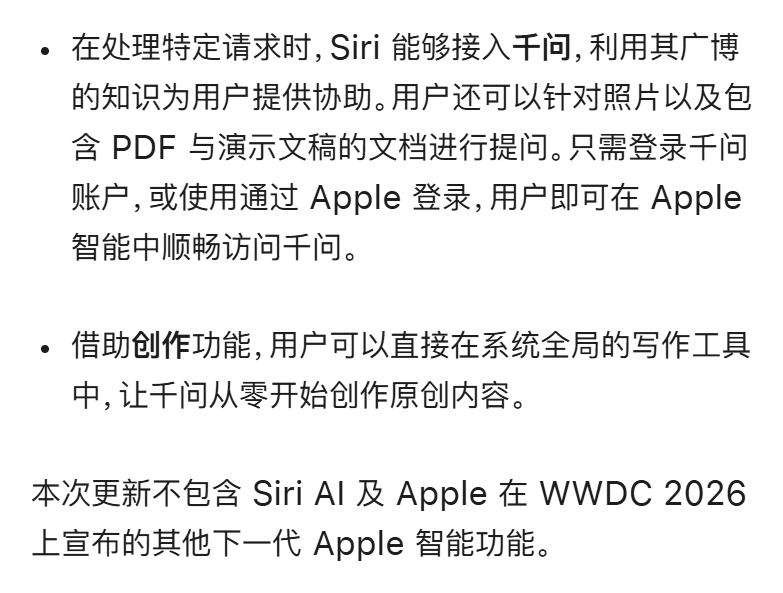
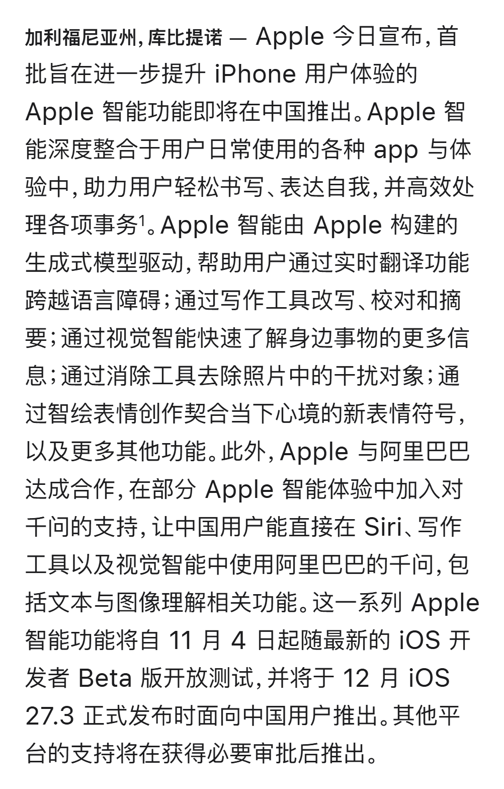
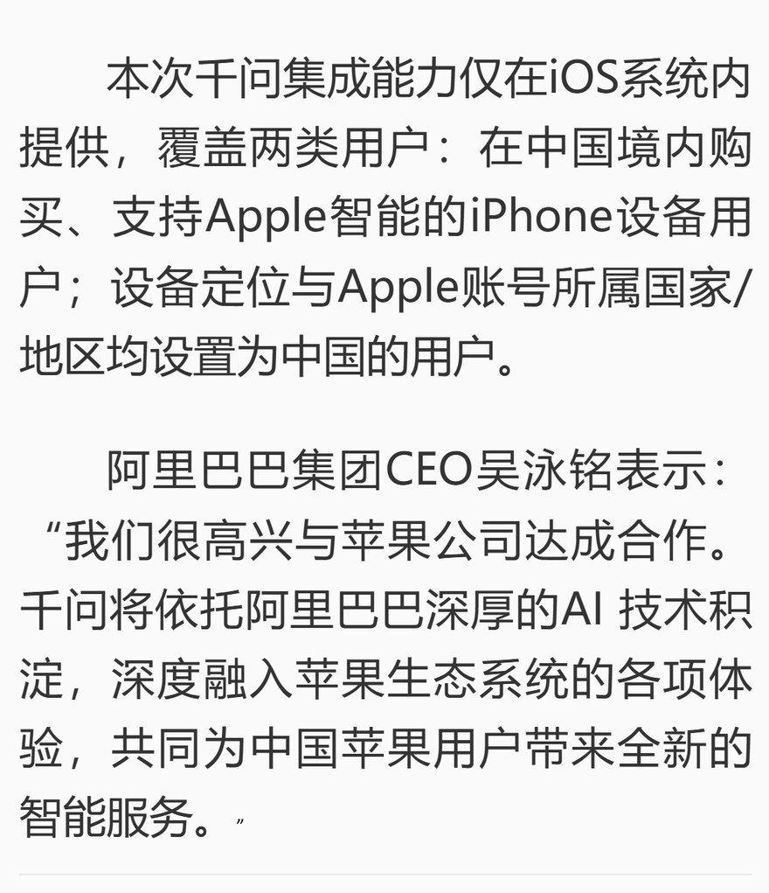

10 月 31 日，苹果中国官网挂出一条新闻稿，标题很朴素：《Apple 智能即将登陆中国》。

导语段的末尾，夹着一句不长的宣布：Apple 与阿里巴巴达成合作，在部分 Apple 智能体验中加入对千问的支持。

国行 iPhone 等这句话，等了两年多。

<figure class="post-fig"><figcaption>苹果官网新闻稿的首图：三台 iPhone 18 Pro，分别是智绘表情、键入式 Siri、带优先邮件的收件箱。图：Apple Newsroom 中国，2026 年 10 月 31 日。</figcaption></figure>

## 一、接进去的到底是什么

先把"合作"这两个字拆开。

苹果官方原文用的是"**部分** Apple 智能体验"，不是全部。具体是三处：

- **Siri**：处理特定请求时接入千问。你可以针对照片、以及包含 PDF 与演示文稿的文档向它提问。
- **写作工具**：多了个"创作"功能，让千问从零开始写原创内容，也能生成图像。
- **视觉智能**：多了一个"询问千问"，用来识别眼前看到的东西。

登录有两种：用千问账户，或者用"通过 Apple 登录"。整个功能可以在设置里一键关掉。阿里也承诺，不把用户的提问和模型回复拿去训练。

苹果在新闻稿里列了首批 16 项功能。我数了一遍，按下单顺序是：实时翻译、写作工具、视觉智能、照片消除、智绘表情、照片自然语言搜索、回忆影片、优先邮件、邮件摘要、智能回复、通知摘要、首要通知、减少干扰专注模式、备忘录音频转录摘要、通话转录摘要、Siri 键入对话。

**16 项里，只有 3 处接了千问。剩下 13 项，跑的是苹果自己构建的生成式模型。**

<figure class="post-fig"><figcaption>16 项首批功能，紫色是接入千问的三项。数据：Apple Newsroom 中国，2026 年 10 月 31 日；图为本刊绘制。</figcaption></figure>

这个比例值得停一下。

过去一周中文互联网上的说法大多是"苹果把中国 AI 交给了阿里"。更准确的说法是：**苹果自己做完了一大半，只在三件事上借了阿里的手——它自己那颗模型在中文语料和本地知识上不够用的那三件事。**

<figure class="post-fig"><figcaption>苹果官方的&quot;键入式 Siri&quot;示意图。千问接入的第一个入口就在这里。图：Apple Newsroom 中国。</figcaption></figure>

关你什么事： 如果你只想知道"我的 iPhone 会不会突然变得很中国"——不会。变的只有三处，而且每一处都要你先点同意。剩下那 13 项，跟海外版是同一套东西。

## 二、一张许可证上，并排着三个备案号

真正能说明"装进去的是什么"的，不是新闻稿，是工信部那张进网许可证。

10 月 14 日，工信部电信设备进网许可公示更新：苹果首款折叠屏 iPhone Duo（国行型号 A3721）在 9 月 29 日完成换证，许可文件里新增了设备搭载大模型的备案编号。

一共三个。

<figure class="post-fig"><figcaption>三个备案号并列在同一张进网许可证上，依次对应 Apple 智能、通义万相、通义千问。数据：工信部入网许可公示，经澎湃新闻 2026 年 10 月 31 日报道；图为本刊绘制。</figcaption></figure>

第一个是 `Shanghai-AppleZhiNeng-202506160057`，对应 Apple 智能。第二个是 `Shanghai-TongYiWanXiang-202410090024`，对应通义万相。第三个是 `ZheJiang-TongYiQianWen-20230901`，对应通义千问。

所以装进国行 iPhone 的，从来不是"一个中国大模型"，是**三个**：苹果自己一个，阿里两个——一个管语言，一个管图像。

这里有个细节：**通义万相在许可证上，但苹果的新闻稿里一个字都没提它。**

千问负责哪三处，官方写得很清楚。万相负责什么，官方没说。按名字推测是图像生成，但那只是推测。一台手机里备了案却没说用途的模型，这件事本身比"合作"两个字有意思。

顺带说一句这几个编号里的日期。通义千问是 `20230901`——2023 年 9 月，那是国内第一批大模型备案的时间。通义万相是 `20241009`。Apple 智能是 `20250616`。三个模型，三个时代。

关你什么事： 以后判断"某家外国公司用了中国 AI"，别看新闻稿，去看入网许可。许可证上写几个备案号，就是真装了几个。

## 三、12 月给的那一版，缺了最要紧的一块

苹果新闻稿里有一句话，被大部分转述略过了：

**"本次更新不包含 Siri AI 及 Apple 在 WWDC 2026 上宣布的其他下一代 Apple 智能功能。"**

这句话的意思是：你在 12 月拿到的，是 2024 年 6 月 WWDC 上那批功能的迟到版。今年 WWDC 上那套能看屏幕、能跨 App 操作的新 Siri，不在里面。

<figure class="post-fig"><figcaption>苹果官方原文：「本次更新不包含 Siri AI 及 Apple 在 WWDC 2026 上宣布的其他下一代 Apple 智能功能。」上面两段是千问接入的两处说明。截图：Apple Newsroom 中国。</figcaption></figure>

时间线摆出来是这样的：Apple 智能 2024 年 6 月发布，2024 年 10 月随 iOS 18.1 向海外用户开放。国行版原计划 2025 年 5 月上线，后来推到 2025 年底，又推到 2026 年春季，最后落在 2026 年 12 月。

**两年两个月。**

门槛也还在。机型上要 iPhone 15 Pro、15 Pro Max、iPhone 16 及后续、iPhone Air 或 iPhone Duo；Siri 与设备语言都要设成英文或简体中文；设备定位和 Apple 账户的国家/地区都得是中国，或者设备本身在中国境内购买。iPad 和 Mac 要等"获得必要审批后"再推。

<figure class="post-fig"><figcaption>苹果新闻稿原文。11 月 4 日开发者 Beta，12 月 iOS 27.3 正式版，其他平台等审批。截图：Apple Newsroom 中国。</figcaption></figure>

关你什么事： 12 月推送之后，如果你用的是 iPhone 14 或更早的机型，这件事跟你没关系——端侧模型跑不动，苹果不会给你降级版。你唯一的感受会是：同事的手机能一键摘要邮件了，你的不能。

## 四、这场谈判谈了 20 个月

最后说时间。

2025 年 2 月 13 日，迪拜世界政府峰会。阿里董事局主席蔡崇信第一次公开确认了这件事，原话是："他们和中国的很多公司谈过，最终选择和我们做生意，用我们的 AI 驱动他们的手机。"

消息当天，阿里港股涨超 9%，创三年新高。

然后是漫长的等待：2026 年 7 月 8 日，网信办公示苹果技术开发（上海）有限公司的 Apple 智能完成生成式 AI 服务备案；9 月 29 日，入网许可换证；10 月 15 日，库克在上海确认已获批；10 月 31 日，正式官宣。

从公开确认到正式落地，20 个月。

<figure class="post-fig"><figcaption>央广网 10 月 31 日的报道，含吴泳铭的表态与覆盖范围。截图：cnr.cn。</figcaption></figure>

为什么是阿里？外面流传的解释很多：百度技术磨合不顺、腾讯字节有业务冲突、DeepSeek 撑不起苹果级别的需求量、阿里地缘风险最低。这些说法都来自二手分析，苹果和阿里都没有公开过筛选标准，我不替他们编。

能确定只有一件事：**苹果没有自研一套中国模型，而是选了一个"最不像竞争对手"的伙伴。** 阿里不做手机，不跟 iPhone 抢硬件入口，这是它相对其他候选最干净的一点。

这也解释了为什么是"部分体验"而不是"全部"——合作边界划得越清楚，苹果让渡的系统控制权就越少。

关你什么事： 这场合作里最值钱的东西不是技术，是"进得去"这三个字。国产大模型接下来的比拼，会从"谁跑分高"变成"谁进了谁的系统"。千问拿到的是 iPhone 的系统级入口，这是任何独立 App 花钱都买不来的位置。

---

把三件事排一起看：

苹果自己做完了 16 项里的 13 项，说明它的模型不是不能用，是不够懂中文的那些具体场景；千问补的正是那三块；而真正决定体验上限的新 Siri，苹果宁可让它缺席，也不肯交出去。

**它交出去的是"能查能写能认"这三件具体的事，没交出去的是"Siri 该长什么样"。**

12 月推送那天，长按 Siri 问一句复杂问题，如果答案背后是千问——你会看到一条很清楚的界线：哪些能力苹果愿意借，哪些它一定要自己攥着。

今日新闻烟火记录完毕

愿你在等推送的时候，先看清那张许可证上写了几个名字。
