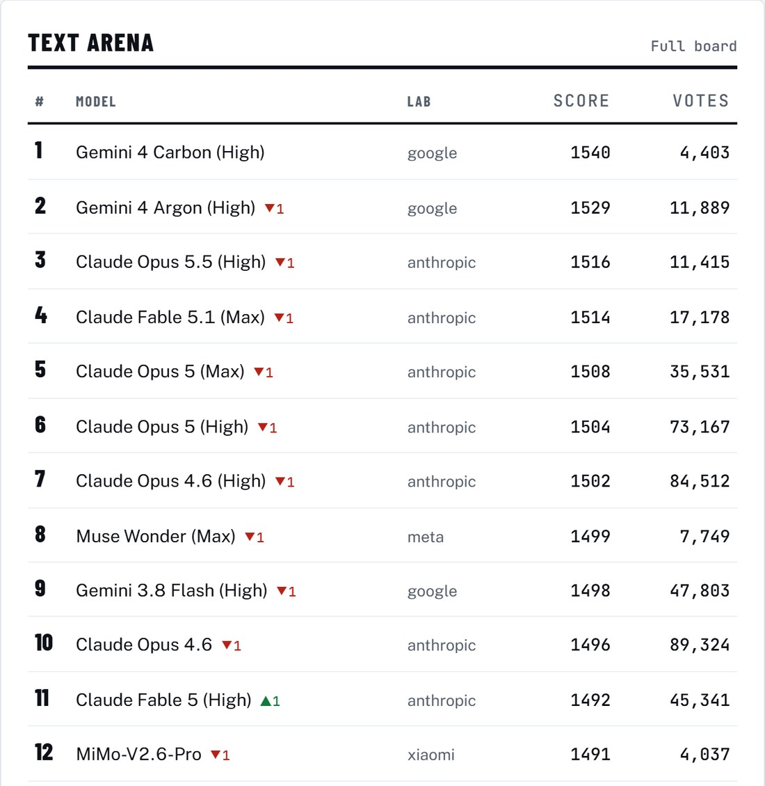
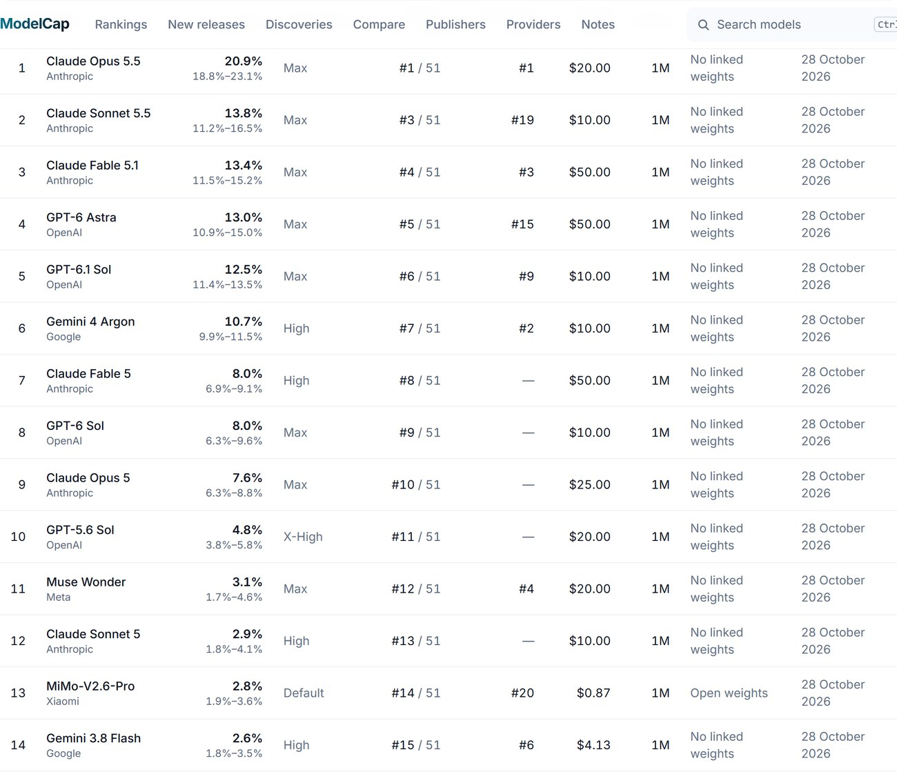
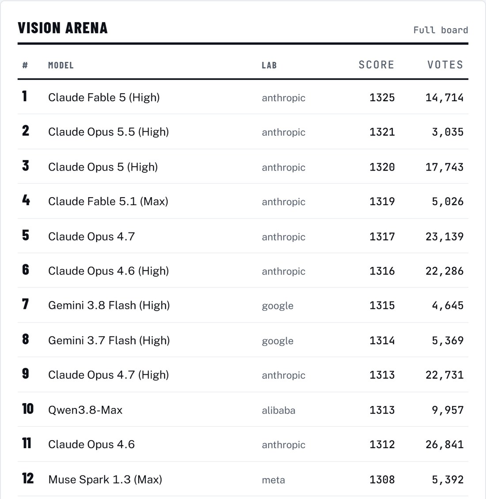
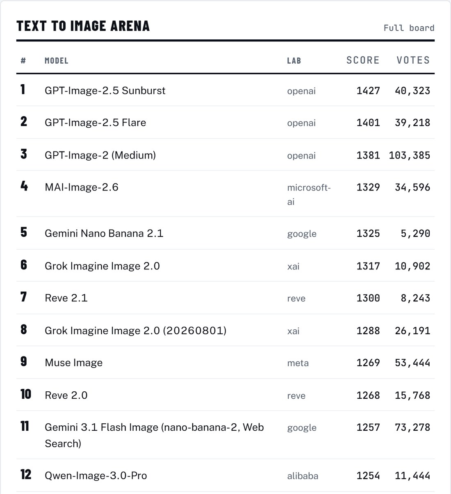
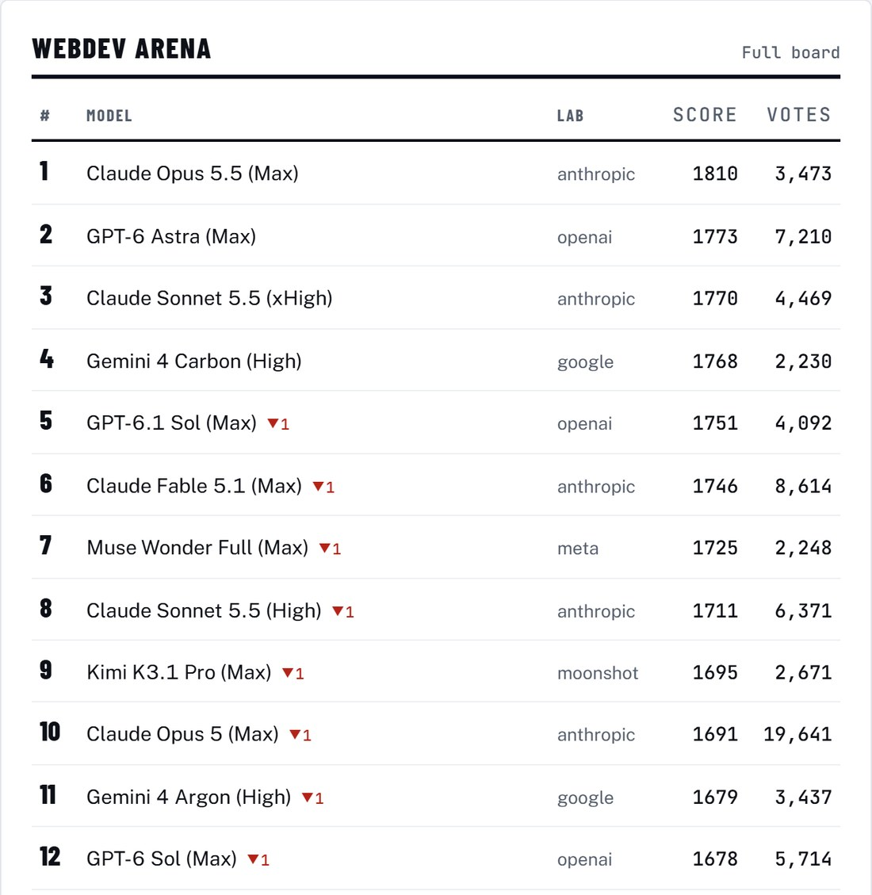
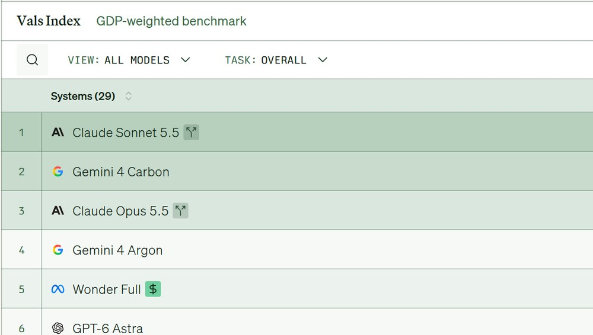
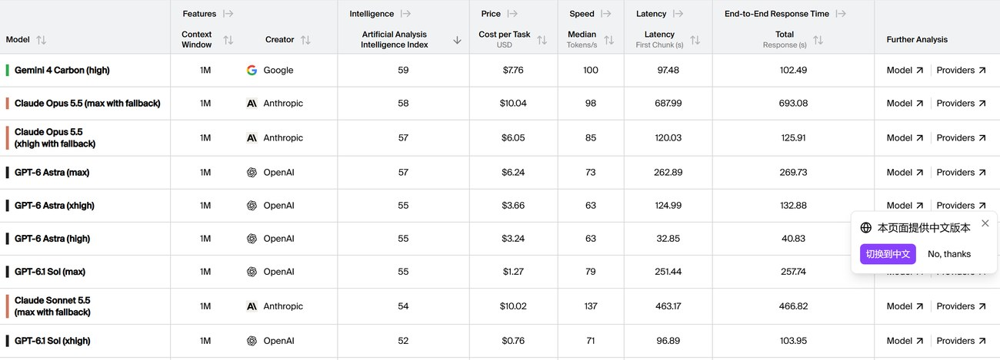

10 月 19 日到 28 日，十天，LMArena 发了四张榜：视觉（19 日）、文生图（26 日）、文本和前端开发（都是 28 日）。

10 月 28 日，谷歌发布 Gemini 4 Carbon。同一批榜里，文本榜第一就是它：1540 分，4,403 票。

但它只对 Fairwind 计划里的网络安全防御者开放。开发者、企业、普通用户，没有时间表。没有公开 API，定价页上还查不到这个型号。

**榜首是一个你调不到的模型。**

四张榜摆在一起看，最该记住的是这件事：榜单在给一个还买不到的东西排位。

## 一、四千票的第一，十三万票的第二十名

<figure class="post-fig"><figcaption>LMArena 文本榜前十二名（裁切，以下略去）。第一 Gemini 4 Carbon 1540 分，4,403 票；第二 Argon 1529 分，11,889 票。每个下滑箭头都是这一期被挤下去的位子。截图：whatisthelatest.ai/leaderboards（数据源 LMArena），2026 年 10 月 29 日。</figcaption></figure>

把这张表按票数看一眼，顺序会很难看。

第 1 名 Carbon，4,403 票。第 20 名 Gemini 3.1 Pro Preview，1480 分，132,547 票。

分差 60 分，票差 30 倍。同一个实验室，新旧两代，隔了 19 个位子。

这不是榜错了，是 Elo 的本性。众包盲投算出来的分数，是均值加方差：一个模型被投了两年、十三万次，位子就钉死了；一个刚上榜、四千票，置信区间宽得能塞进一整个梯队。

第 12 名 MiMo-V2.6-Pro 1491 分，4,037 票。第 16 名 Qwen3.8-Max 1483 分，31,915 票。8 分之间，票差 8 倍。

**票少于五千的名字，两周后会掉。** 掉三到五位的居多，掉出前十的也有。

前十 Anthropic 坐六个位置，前二十坐九个。这个密度是两年投票堆出来的，一周堆不出来。

关你什么事： 看到"新模型空降第几"，先翻票数那一列。票少的名次是期权，不是现货；等它投满两周再看，误差会小一半。

## 二、智能体榜：第一名的绝对值只有 20.9%

<figure class="post-fig"><figcaption>LMArena 智能体榜前十四行（裁切）。净提升度：第一名 20.9%（区间 18.8–23.1），第二到第五行还在 13% 上下，第十行只剩 4.8%，第十三行的 MiMo-V2.6-Pro 是 2.8%。原始榜单在这家站点被按分数重排过，最右列的 #14 / 51 才是 LMArena 的名次。截图：modelcap.ai/benchmarks/lmarena-agent（数据源 LMArena，快照 2026 年 10 月 28 日）。</figcaption></figure>

10 月 28 日那期，第一是 Claude Opus 5.5（Max），净提升度 20.9%。第二 Sonnet 5.5 13.8%，第三 Fable 5.1 13.4%，第四 GPT-6 Astra 13.0%。

中国最好的 MiMo-V2.6-Pro，2.8%。

差 7.5 倍。

这张榜量的不是分数，是几件更硬的事。上一期（10 月 23 日）把细项列得更全：任务确认成功率 22.08%，工具幻觉率 0.57%，每个任务 6.36 美元、18 分钟。

22.08% 的意思是，给它一个多步任务，十次里两次多一点能走到"确认完成"。剩下七次多不是失败，是"没确认"——它做了，你不知道做完没有。

0.57% 的意思是，每调用一百次工具，有半次是凭空编出来的调用。

一个模型可以答得很漂亮，然后在你让它改服务器配置的时候，编一个不存在的文件路径。

**Opus 5.5 赢在这个地方。** 这张榜比的不是"会不会"，是"敢不敢交给它"。

关你什么事： 拿模型做自动化，别只看答得对不对，看它敢不敢自己点"确认"。22.08% 的意思是任何流程都得有回滚，而且回滚要一键。

## 三、国产的四个位置

<figure class="post-fig"><figcaption>LMArena 视觉榜前十二名（裁切）。前六全是 Anthropic，第七、第八才是 Gemini 的两张卡。中国最好的 Qwen3.8-Max 在第十，1313 分。截图：whatisthelatest.ai/leaderboards（数据源 LMArena），2026 年 10 月 29 日。</figcaption></figure>

<figure class="post-fig"><figcaption>LMArena 文生图榜前十二名（裁切）。前三全是 OpenAI，第一 1427 分。中国最好的 Qwen-Image-3.0-Pro 在第十二，1254 分——中间隔着十一个位子、173 分。截图：whatisthelatest.ai/leaderboards（数据源 LMArena），2026 年 10 月 29 日。</figcaption></figure>

并排放，会很安静。

文本榜前二十，两个中国名字：MiMo-V2.6-Pro 第 12（1491），Qwen3.8-Max 第 16（1483）。

前端开发榜好看些：Kimi K3.1 Pro 第 9（1695），Qwen3.8-Max（0902）第 13（1676），DeepSeek-V4.1-Flash 第 16（1665）。

视觉榜：前六全是 Anthropic。中国最好的 Qwen3.8-Max 排第十，1313 分。第一名 1325，差 12 分，中间隔着八张卡，六张是 Anthropic。

文生图最差：前三全是 OpenAI，第一名 1427。中国最好的 Qwen-Image-3.0-Pro 第十二，1254。往前数 173 分，中间隔了十一个位置。

<figure class="post-fig"><figcaption>LMArena 前端开发榜前十二名（裁切）。第一名 1810 分 3,473 票，第九是 Kimi K3.1 Pro，1695 分 2,671 票——票数只有冠军的七成七，分差 115。截图：whatisthelatest.ai/leaderboards（数据源 LMArena），2026 年 10 月 29 日。</figcaption></figure>

然后看另一张榜，画风突变。

10 月 2 日的开源权重榜：中国最好的 MiMo-V2.6-Pro 1491，美国最好的 Nemotron 3 Ultra 1445，欧洲最好的 Mistral Large 3 1428。

中国领先美国 46 分，领先欧洲 63 分。一年前这个差距是 72 分。

差距收窄了，但不是中国退了——中国最好那一款这一年涨了 63 分。是 Gemma 4 三月上来、Nemotron 3 Ultra 七月补位，把美国的线抬起来了。

关你什么事： 综合榜第几名，你感受不到。开源权重榜领先 46 分，你是能下载的——能私有化、能微调、能在断网的内网里跑。这两件事对你的价值差着一个数量级。

## 四、同一周，三个口径，Kimi 三个位置

<figure class="post-fig"><figcaption>Vals Index 前十二名（裁切）。Claude Sonnet 5.5 70.85%，Gemini 4 Carbon 70.36%，Opus 5.5 70.18%；国产最好的是 Kimi K3.1 Pro 62.52%，排第七。这张榜只测四类任务：金融、编码、法律、税务。截图：vals.ai/benchmarks/vals_index，2026 年 10 月 27 日。</figcaption></figure>

<figure class="post-fig"><figcaption>Artificial Analysis 智能指数 v5.0 前九行（裁切，按推理档位分行：同一模型的不同档位各占一行，所以 Opus 5.5 出现两次）。Carbon 59 分居首，Opus 5.5 最高档 58 分，Sonnet 5.5 最高档 54 分已在第八行。Kimi K3.1 Pro 的 46 分在二十名开外，不在这张裁图里——正文引用的那个数字往下滚可见。截图：artificialanalysis.ai/leaderboards/models，2026 年 10 月 29 日。</figcaption></figure>

同一个模型，同一个星期，三家机构，三个位置。

Kimi K3.1 Pro：LMArena 前端开发榜第 9，1695 分。Vals Index 第 7，62.52%。Artificial Analysis 智能指数 46 分——榜首 Carbon 是 59。

从"全球前九的前端模型"到"比榜首低 13 分"，中间没有谁错了。

再看 Vals 这张。Claude Sonnet 5.5 70.85%，Gemini 4 Carbon 70.36%，Opus 5.5 70.18%。国产第二梯队：Kimi 62.52%、DeepSeek-V4.1-Flash 61.26%、GLM 5.3 59.73%、Qwen3.8-Max（0902）59.05%。

**这些榜之间不能直接比。**

Vals 量的是金融、编码、法律、税务四类任务的准确率，按行业占美国 GDP 的份额加权——它回答"值多少钱"。AA 量的是综合智能指数——它回答"有多聪明"。LMArena 量的是人看了两个答案，更喜欢哪个——它回答"讨不讨人喜欢"。

三个问题的答案，本来就不该一样。

所以以后看到"某模型超过某旗舰"，第一句该问的是：哪张榜，谁投的票，什么任务集。

**一张榜已经不是答案了，是一份证词。**

关你什么事： 拿榜单当采购依据之前，先找一张跟你活儿最像的榜。写代码看前端榜，跑客服看 Vals 那种按行业加权的，做创意看生图榜。用综合榜挑工具，等于用平均体温判断病。

---

四张榜，四个第一，落在三家手里：Google 一个，Anthropic 两个，OpenAI 一个。

而 Google 拿到的那一个，靠的是一个还没开放的模型。

Carbon 现在同时是文本榜第一、前端榜第四、Vals 第二、AA 第一。四个口径都认它，能调它的是一份筛选过的名单。

所以这一期的"第一"，更该读成预告，不是现货。

国产的位置也清楚了：综合榜在第二梯队，前端榜挤进前十，视觉紧贴第一集团但前面堵着六张 Anthropic，生图掉在梯队外，开源权重世界第一。这几个位置，几种处境，别混着说。

关你什么事： 别问"现在最强的模型是哪个"。问"我这件活，哪张榜上排第一的是谁，以及那个第一我现在能不能用"。

今日新闻烟火记录完毕

愿你在满屏第一里，认得出那个真能替你干活的。
