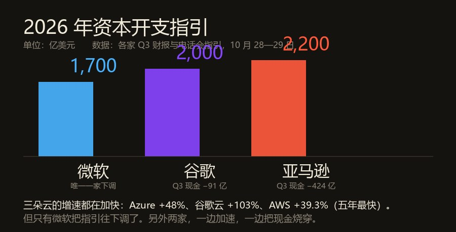
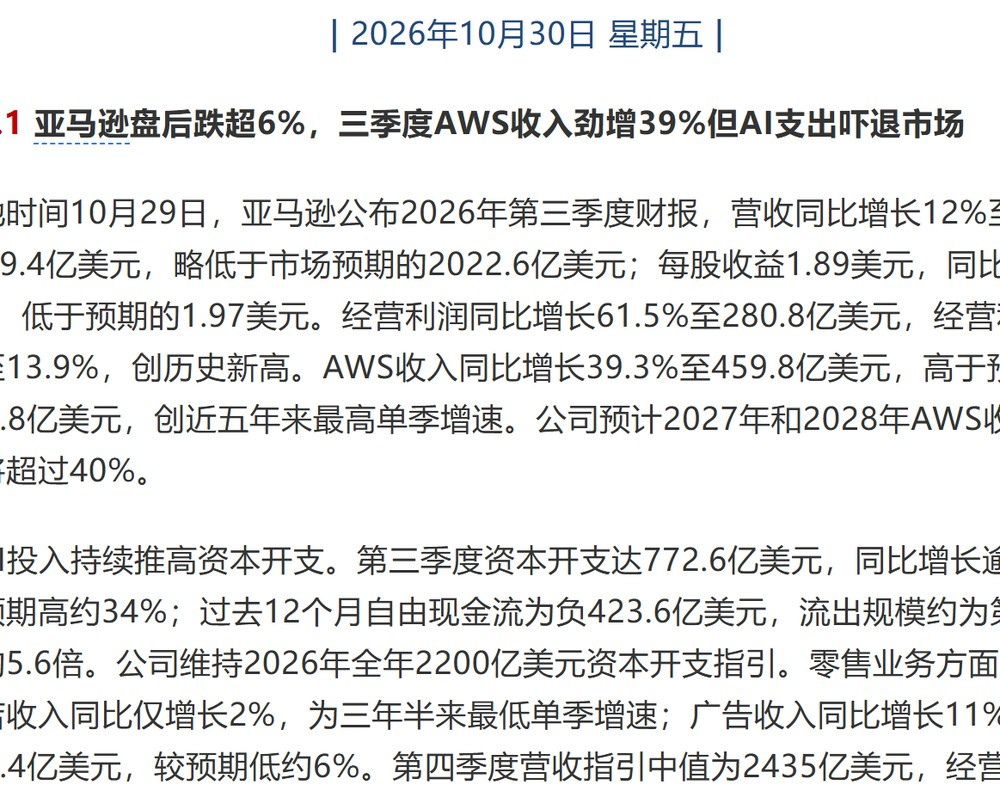
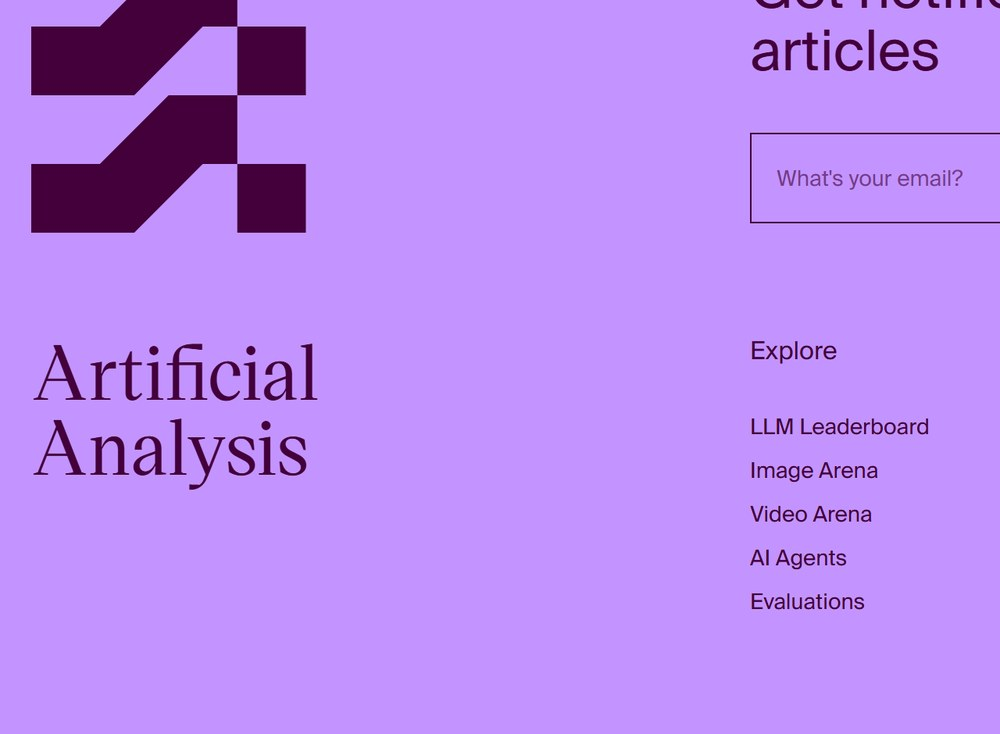
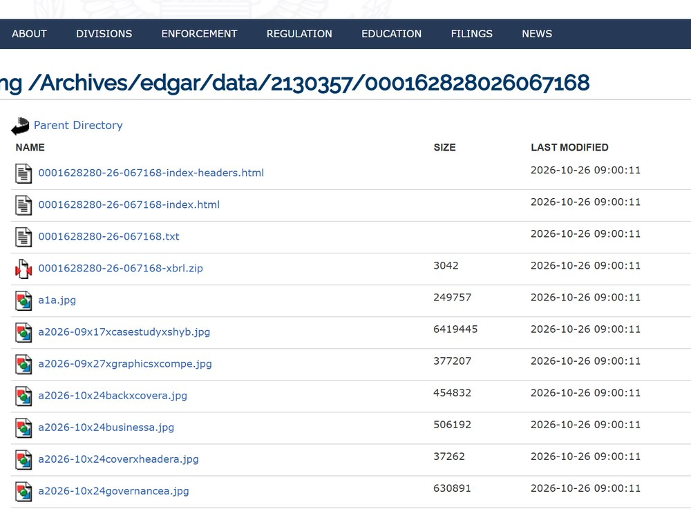
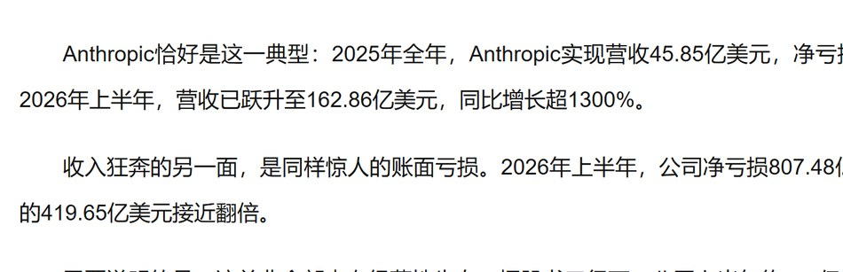
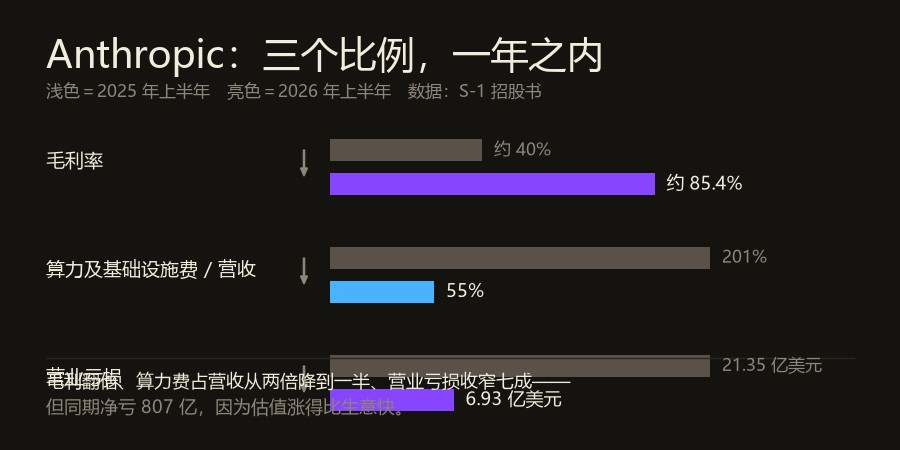
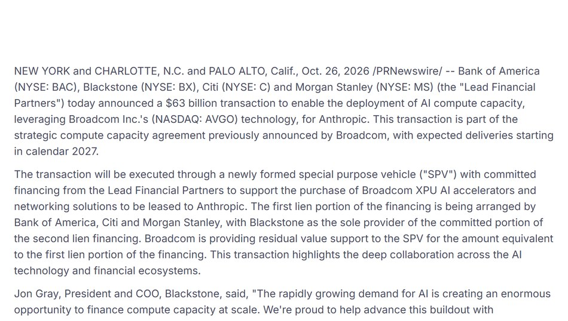

10 月 29 日美股盘后，亚马逊和英特尔同时交卷。

亚马逊营收 2,019.4 亿（+12%，低于预期），经营利润 280.8 亿（+61.5%，利润率 13.9%，公司史上最高）。AWS 459.8 亿，+39.3%，近五年最快。

同一份财报里，第三季度自由现金流 **−423.6 亿美元**。去年同期是 +147.9 亿。

**生意好得前所未有，现金也烧得前所未有。**

## 一、三朵云都在加速，两本现金账先烧穿了

<figure class="post-fig"><figcaption>三家云厂商的 2026 年资本开支指引。微软是唯一一家把指引往下调的，另两家一边加速一边把现金烧穿。数据：各家 2026 年第三季度财报与电话会，10 月 28—29 日；图为本刊绘制。</figcaption></figure>

把三家放一张表上，会看到一个从没出现过的组合。

微软：Azure 增速 48%（上季 43%），资本开支指引从 1,750 亿下调到 1,700 亿。

谷歌：云增速 103%，单季自由现金流 −90.7 亿，连续第二个季度为负。2027 年资本开支预计超过 3,000 亿。

亚马逊：AWS 增速 39.3%，单季自由现金流 −423.6 亿，是上一季的 5.6 倍。全年资本开支 2,200 亿不变。

三家云全在加速。两家现金转负，第三家开始往回收。

<figure class="post-fig"><figcaption>今早的科技早参。亚马逊与英特尔两份财报的关键数字都在这一页：AWS +39.3%、经营利润率 13.9% 创历史新高、资本开支 772.6 亿比预期高 34%、自由现金流 −423.6 亿。截图：腾讯新闻，2026 年 10 月 30 日。</figcaption></figure>

同夜的英特尔是另一面。营收 165 亿（+21%），调整后每股收益 0.52 美元，都超预期。但第四季度指引 150—160 亿，市场预期 170 亿；每股收益指引 0.25，预期 0.43—0.45。

盘后跌 23%。10 月以色列工厂爆炸，第四季度要少 3 亿营收、压 200 个基点毛利；PC 芯片业务同比 −5%，公司说 PC 至少弱到 2027 年上半年。

一家在借钱买未来，一家在等旧生意回暖。

关你什么事： 云在加速，不等于云在变便宜。三家都是用今年的现金买明年的算力，这笔账最后只有两种收场方式——涨价，或者折旧。

## 二、同一天，欧洲把 1T 参数的全量权重放了出来

<figure class="post-fig"><figcaption>Artificial Analysis 榜上 Mistral Large 4 那一段（局部裁切，只留模型、智能指数、每任务成本三列）。Large 4（high）26 分、每任务 2.06 美元；紧挨着上面一行的小米 MiMo-V2.6-Flash 是 27 分、0.13 美元。截图：artificialanalysis.ai，2026 年 10 月 30 日。</figcaption></figure>

10 月 29 日，Mistral 把 Mistral Large 4（Le Chonk）的权重放出来了。

1 万亿总参数，每 token 激活 490 亿（含嵌入与输出层 520 亿）；100 万 token 上下文；3,800 张 Grace Blackwell 在欧洲自建机房里从零训练。许可用的是改良 MIT——可以免费用、改、微调、商用，唯独拿它做对外模型服务要单独谈商业许可。

API 价：输入 0.70 美元、缓存 0.07、输出 2.10，每百万 token。

它自己的成绩单很硬：Cognition 的 FrontierCode 2.0 拿 19.7%，开源第一；AA 编码智能体指数 48%，与 GLM-5.3 并肩，但平均每任务少用 47% 的 token；Terminal-Bench 4.0 从预览版的 28% 涨到 41%。

**然后在综合智能上，它只有 26 分。**

同一天我在 AA 榜上核到的：小米 MiMo-V2.6-Flash 是 27 分，每任务 0.13 美元。Mistral 贵 16 倍，低一分。

还有一句是 Mistral 自己写的免责：这个模型在网络安全上有“被用于发起真实攻击的可能”（potential for uplift to conduct real attacks），所以守卫规则还要继续改。

一个 1 万亿参数的模型，权重挂在网上，然后附一句“它可能被用来打人”。

关你什么事： “开源第一”要先问是哪个榜。它在编码榜上确实第一，在综合智能上落后一档——你要的是写代码的那一种强，还是通用的那一种？这是两件事。

## 三、Anthropic 的 807 亿亏损，724 亿不是钱

<figure class="post-fig"><figcaption>SEC EDGAR 上 Anthropic 的申报目录页。CIK 0002130357，S-1 备案号 0001628280-26-067168，2026 年 10 月 26 日提交。那个 224 MB 的正文就是招股书。截图：sec.gov，2026 年 10 月 30 日。</figcaption></figure>

<figure class="post-fig"><figcaption>同一份招股书，中文媒体这样拆：上半年净亏 807.48 亿，其中约 720 亿来自可转债等金融工具的公允价值变动；营业亏损从上年同期的 21.35 亿收窄到 6.93 亿。截图：证券时报网，2026 年 10 月 30 日。</figcaption></figure>

10 月 26 日，Anthropic 向 SEC 公开递交 S-1，代码 “ANT”，拟在纳斯达克全球精选市场挂牌。

数字是这样的：2026 年上半年营收 162.86 亿美元，同比增长约 1300%；第二季度营收 115.55 亿，GAAP 营业利润 9.74 亿——招股书披露期内第一次单季营业利润转正，Non-GAAP 口径 22.35 亿，利润率 19%。

同一份文件里写着：上半年净亏损 807.48 亿美元，2025 年全年净亏 419.65 亿。

800 亿的亏损，听着像天塌了。但拆开看，其中约 720 亿来自可转换票据、衍生负债这些金融工具的公允价值变动——公司估值越高，这些工具的账面值越高，会计上就越“亏”。它不是现金，一分钱都没出去。

<figure class="post-fig"><figcaption>三个比例，一年之内的变化。毛利率从约 40% 升到约 85.4%；算力及基础设施费用占营收的比例从 201% 降到 55%；营业亏损从上年同期的 21.35 亿美元收窄到 6.93 亿美元。数据：S-1 招股书；图为本刊绘制。</figcaption></figure>

真正的经营面是这样：营业亏损从上年同期的 21.35 亿收窄到 6.93 亿；毛利率从 2025 年的约 40% 升到今年上半年的约 85.4%；算力与基础设施费用占营收的比例，从 201% 降到 55%；净收入留存率 900%，且没有一家客户贡献超过 10% 的收入。

第三季度单季营收 168 亿，环比涨 45%。

关你什么事： 看模型公司的财报，第一眼别看净利润，看“营业利润”和“毛利率”。净利润里装着估值，毛利率里只装着生意。

## 四、谁在给这些芯片兜底

<figure class="post-fig"><figcaption>博通新闻稿原文。630 亿美元的结构里，第一顺位 450 亿由美银、花旗、摩根士丹利安排，第二顺位 180 亿由黑石独家承诺；博通提供与第一顺位等额的残值支持——它既不是借款人，也不是贷款人。截图：broadcom.cn，2026 年 10 月 30 日。</figcaption></figure>

10 月 26 日，美国银行、黑石、花旗、摩根士丹利联合宣布一笔 630 亿美元的交易，为 Anthropic 部署算力。

做法不是借钱给 Anthropic。四家机构组一个特殊目的实体（SPV），用这笔钱买博通的 XPU 加速器和网络设备，再把设备租给 Anthropic。5 年、4 个厂址、2027 年开始交付。

第一顺位 450 亿，由美银、花旗、摩根士丹利安排；第二顺位 180 亿，黑石独家承诺。

最要紧的是博通的位置。它给这个 SPV 提供“残值支持”，金额等于第一顺位那 450 亿——按 Baird 的测算，2027 年底峰值风险敞口约 430 亿美元，兜的是“未付租金的 72.5% 与退回机架实际价值之间的差额”。

博通既不是借款人，也不是贷款人。它收几百个基点的担保费，把芯片贬值的风险接了一部分过来。

关你什么事： 算力正在被金融化。你看到的是“谁的模型强”，账单上写的是“谁的残值被兜住”。芯片从商品变成了抵押物，这条链上任何一环松动，传导方式都和上一轮不一样。

---

把这四件事排在一起，是一条链。

云在加速，说明需求是真的；现金在烧，说明算力是真的贵；于是要借钱买芯片，借法复杂到要专门的 SPV；于是要上市，账本必须好看；而开源那条线上，欧洲刚把 1 万亿参数的权重放出来，能力还没追上。

**这一轮真正的胜负，不在榜单上，在利息上。**

今日新闻烟火记录完毕

愿你在满屏的“加速”里，看得见那本负现金流的账。
