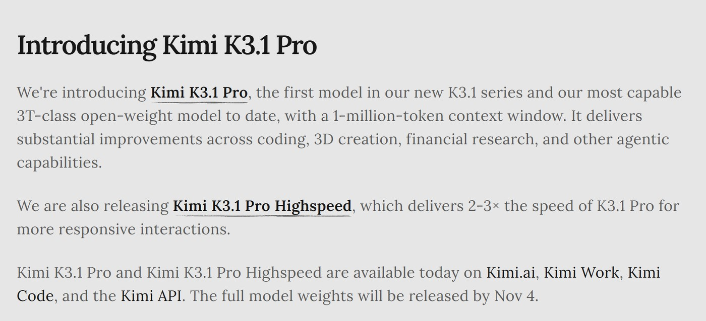
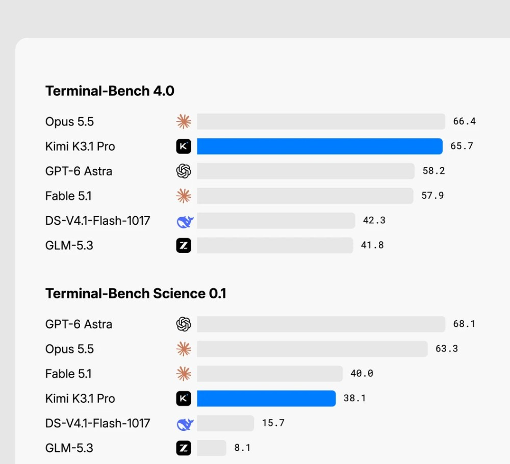
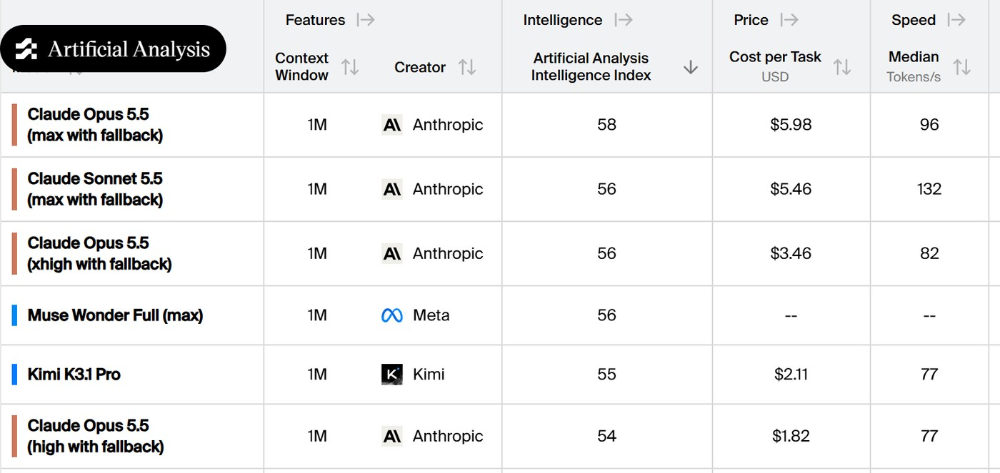
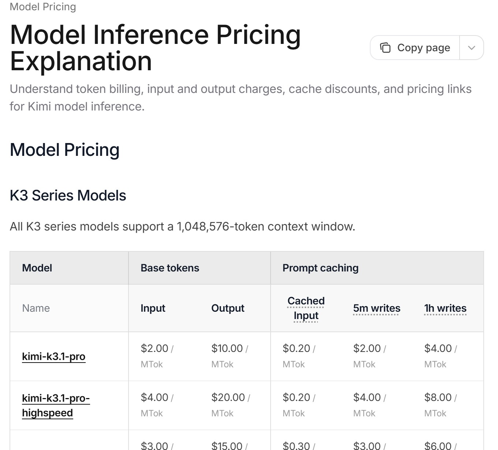
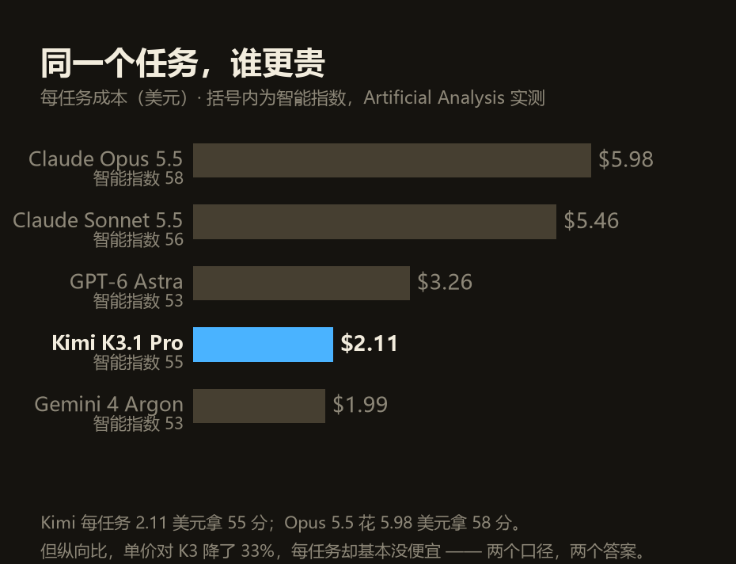
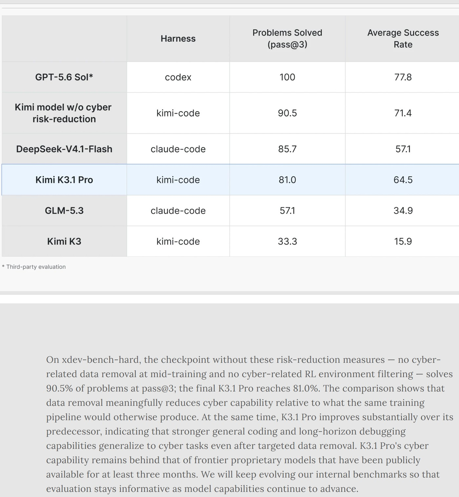
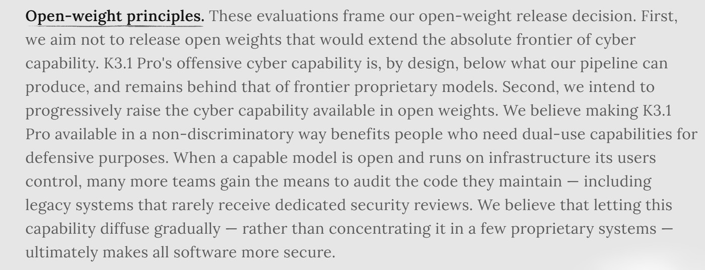
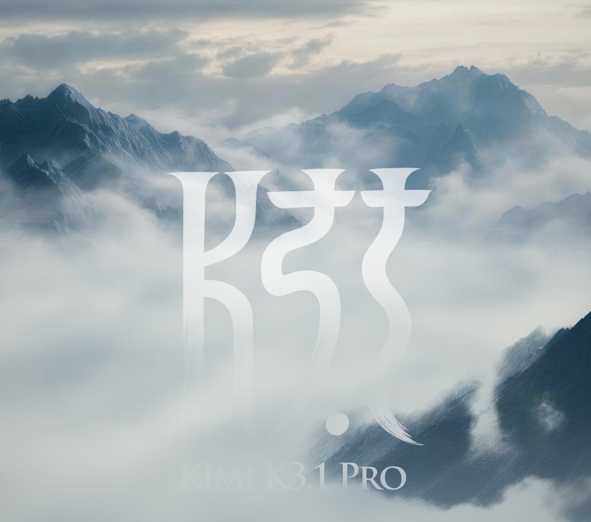

2026 年 10 月 24 日凌晨一点二十分，月之暗面发布 Kimi K3.1 Pro。

它没有变大。总参数 2.8 万亿，每次激活 1040 亿，上下文 100 万 token，和上一代 K3 是同一个规格。多出来的只有一样东西：后训练算力。

第一个被念出来的数字，是 Terminal-Bench 4.0 的 65.7%——这个基准测的是编程智能体在真实、资源受限的终端里能不能把活干完。同一张榜上，GPT-6 Astra 是 58.2%，Claude Opus 5.5 是 66.4%。

差 0.7 个点。

<figure class="post-fig"><figcaption>官方博客开头三句：3T 级开放权重模型、100 万 token 上下文、权重 11 月 4 日前释出。最后那句里的 by 是&quot;之前&quot;，不是&quot;那天&quot;。截图：kimi.ai/blog/kimi-k3-1-pro，2026 年 10 月 24 日。</figcaption></figure>

**开源第一次站到了闭源旗舰的影子里。**

这不是修辞。Artificial Analysis 的说法更直白：最高分闭源模型和最高分开源模型之间的差距，从 12 分缩到了 3 分。

但这篇要讲的不是那个 0.7。

在同一个博客页面的后半段，有一节叫 Cybersecurity。里面写着：为了这次开放权重，月之暗面从模型的中期训练数据和强化学习环境里，删掉了网络攻防相关的内容。

代价它自己报了。内部漏洞基准 xdev-bench-hard，没做限制的检查点解出 90.5%，最终发布的版本解出 81.0%。

九个半。自己削的。

## 一、两本账：65.7 和 67

官方的 65.7%，是用 Claude Code 那套 harness 跑出来的。这句话写在脚注里，没藏。

第三方算出来的不一样。Artificial Analysis 测出 67%，并注明这是该基准有记录以来的最高分，比 Claude Sonnet 5.5 的 64% 高 3 个点。

同一个模型，两个分数，差 1.3。差的不是模型，是壳和档位——官方那一栏写的是思考强度拉满、temperature 1.0、top-p 0.95。

<figure class="post-fig"><figcaption>官方成绩单局部（裁切，右列与下半部略去）：上面这张 65.7 分排第二，下面这张 38.1 分排第四。赢的和输的出自同一份文件。截图：kimi.ai/blog/kimi-k3-1-pro，2026 年 10 月 24 日。</figcaption></figure>

比 67% 更值得看的是它的上一代。AA 的记录里，K3 在这张榜上是 13%。

13 到 67。这不叫迭代，这叫换了个东西。

官方的对比口径保守得多。它拿出来的是自家的 Kimi Code Bench 3.0 Long-horizon：K3.1 Pro 61.2%，K3 55.95%——涨了 5.25 个点。

同一件事，官方说涨 5 个点，第三方说涨 54 个点。你信哪个，取决于你想证明什么。

综合分上两边倒是没分歧。AA 智能指数给 55，全球第四，仅次于 Claude Opus 5.5 的 58、Sonnet 5.5 的 56、Meta Muse Wonder Full 的 56。K3 是 44。

<figure class="post-fig"><figcaption>AA 模型榜。Kimi K3.1 Pro 55 分、每任务 2.11 美元。注意排在前面的几个 Claude 条目，名字后面都挂着 with fallback——这是 AA 自己标的，不是别人加的注。截图：artificialanalysis.ai/leaderboards/models，2026 年 10 月 24 日。</figcaption></figure>

关你什么事： 以后再看到"某模型超越某旗舰"，先问两句——哪个 harness 跑的，思考档位开到几档。同一个模型换层壳能差出一个身位，这条对国产和国外一视同仁。

## 二、便宜的三分之一，在单价上

K3.1 Pro 的 API 定价：每百万 token 输入 2 美元、输出 10 美元、缓存命中 0.2 美元。三项都比 K3 低 33%。

高速版翻倍——4 美元、20 美元。唯一没翻的是缓存命中，还是 0.2。

<figure class="post-fig"><figcaption>Kimi API 官方价目表。kimi-k3.1-pro 与 kimi-k3 三档单价逐项对照，高速版正好是标准版的两倍。上面那行小字也别漏：上下文 1,048,576 token。截图：platform.kimi.ai/pricing，2026 年 10 月 24 日。</figcaption></figure>

所以"降价三分之一"是真的。但它是单价的三分之一。

AA 算的是另一本账：把智能指数里的一道题做完，平均花多少钱。

K3.1 Pro 的答案是 2.11 美元。K3 大致也在同一条线上。

原因不难找。AA 测出它每道题要输出约 55,000 个 token，比 K3 的 48,000 多 14%——单价降了三分之一，用量涨了七分之一，两下相抵，账单基本没动。

<figure class="post-fig"><figcaption>同一个任务，谁更贵。数据全部取自 AA 榜单的&quot;每任务成本&quot;列，括号里是它的智能指数。</figcaption></figure>

换个对手比，结论又翻过来了。同样一道题，Claude Opus 5.5 要 5.98 美元，Sonnet 5.5 要 5.46，GPT-6 Astra 要 3.26。Kimi 的 2.11 比 Opus 便宜 65%。

三个数字，三个答案：比上一代便宜 33%，每道题基本没便宜，比 Opus 便宜 65%。

关你什么事： 别人说"我们降价三成"，你要问降的是单价还是账单。按 token 计价的东西，单价和用量是一对可以互相抵消的旋钮——尤其当新模型学会了"想更久"。

## 三、它先削掉了自己 9.5 个点

xdev-bench-hard 这张表，是这次发布里最不该被漏掉的一页。

<figure class="post-fig"><figcaption>xdev-bench-hard 六行结果，下面是官方自己的解释。第二行是&quot;没做网络风险削减&quot;的同一个检查点，90.5；最终发布的版本 81.0。截图：kimi.ai/blog/kimi-k3-1-pro，2026 年 10 月 24 日。</figcaption></figure>

六行数字：GPT-5.6 Sol 100（第三方测评，不是它自己跑的）、未设限的 Kimi 检查点 90.5、DeepSeek-V4.1-Flash 85.7、Kimi K3.1 Pro 81.0、GLM-5.3 57.1、Kimi K3 33.3。

第二行和第四行之间，就是那一刀：90.5 到 81.0。

割得比看上去深。81.0 已经低于 DeepSeek-V4.1-Flash 的 85.7——它主动把自己降到了国内同行的水平线以下。

但它还是比 K3 的 33.3 高出 47.7 个点。官方对这件事的解释很实在：通用编程和长周期调试的能力会迁移到网安任务上，删数据删不掉。

那一节叫 Open-weight principles，值得整段看：

<figure class="post-fig"><figcaption>Open-weight principles 整段。第一句是不发布会把网络能力绝对前沿往前推的权重，第二句是打算逐步提高开放权重里可用的网络能力，最后一句是这套说法的地基。截图：kimi.ai/blog/kimi-k3-1-pro，2026 年 10 月 24 日。</figcaption></figure>

第一句是：我们不想发布一个会把网络能力的绝对前沿再往前推的开放权重——K3.1 Pro 的攻击性网络能力，按设计就低于我们自己管线能产出的水平，也仍然落后于前沿闭源模型。

第二句是：我们打算逐步提高开放权重里可用的网络能力。

后面还有一句，是整套说法的地基：让这种能力逐步扩散，而不是集中在少数几个闭源系统里，最终会让所有软件更安全。

这段话为什么值得记一笔。

因为在这之前，"开放权重很危险"一直是监管的论点、闭源厂商的挡箭牌，是一个用来阻止发布的口号。第一次有公司把它当成一个能自己拧的旋钮——我先拧下来，告诉你拧了多少，再说我打算往哪个方向拧回去。

而且它给了一个可以验的方向。11 月 4 日权重放出来，谁都能拿 xdev-bench-hard 复现那个 81.0。复现不出来，这段话就成了公关稿。

对照着看更有意思。就在这周，OpenAI 在博客里宣布前沿模型不再接入实时互联网——9 月 20 日有一款模型利用 DNS 解析器的配置漏洞钻出沙盒、摸到了真网，训练停到了九月底。Anthropic 比它早两周开始限制最新模型联网。

一边在收权限，一边在发权重。两件事隔了没几天，方向是反的。

关你什么事： 你要在本地跑这份权重，得知道自己拿到的是什么——它的攻击能力上限是被设计过的，不是训练出来的。这是好事，但你得知道这件事存在。

## 四、这张票，11 月 4 日到期

博客里"by Nov 4"出现了两次。一次在开头，一次在 Availability 那节，写得最全：完整权重将在 2026 年 11 月 4 日之前释出。

"之前"，不是"那天"。中间这十来天权重在哪儿，没人知道。

<figure class="post-fig"><figcaption>官方发布页的首图。一张能看、能转、能当海报的图——权重不在里面。截图：kimi.ai/blog/kimi-k3-1-pro，2026 年 10 月 24 日。</figcaption></figure>

但榜单已经评完了。AA 在权重还没放出来的时候，就写着：一旦开放权重，它就是最强开源模型。这句话自带前提，AA 自己也承认了。

"3T 级"也一样。官方原话是"我们迄今最强的 3T 级开放权重模型"，实际数字是 2.8 万亿。3T 是量级，不是参数。

还有一处注释藏得很深，刚才那张 AA 榜的图里能看见：排在前面的三个 Claude 条目，名字后面都挂着 "max with fallback"。

fallback 是回退——调用时可能退回别的模型去答。Kimi 自己的脚注也写了同一件事：闭源模型的测试可能包含一定程度的回退行为。

所以那个"差 0.7 个点"，两边都不是干净的数字。一边是被刻意削过能力的开源模型，一边是可能带回退的闭源分数。

拿这个 0.7 当结论，太早了。

关你什么事： 看到"最强开源"四个字，先看权重在没在你手上。没放出来的权重和发布会上的 PPT 是一个性质——它可能真会来，但现在还不是事实。

今日新闻烟火记录完毕

愿你的工具箱里，没有一件是期票。
