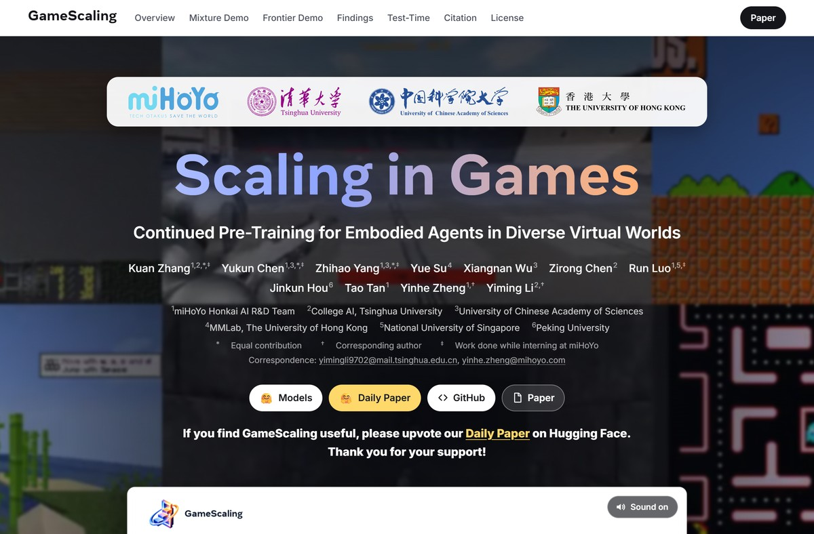
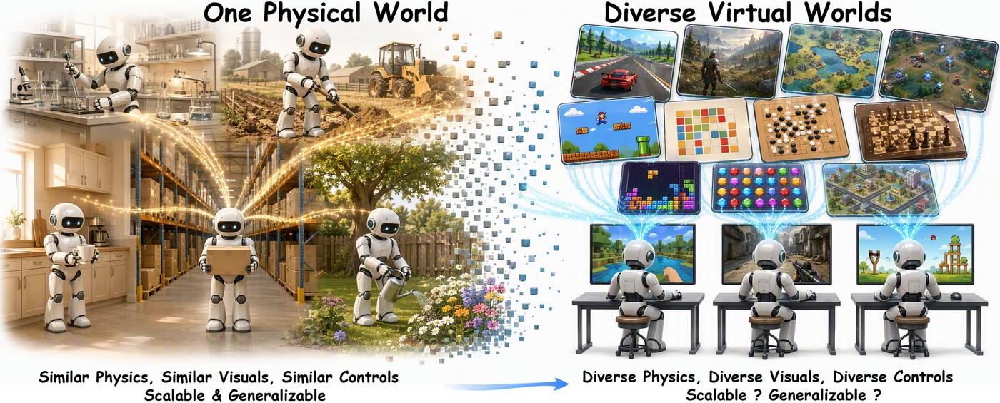
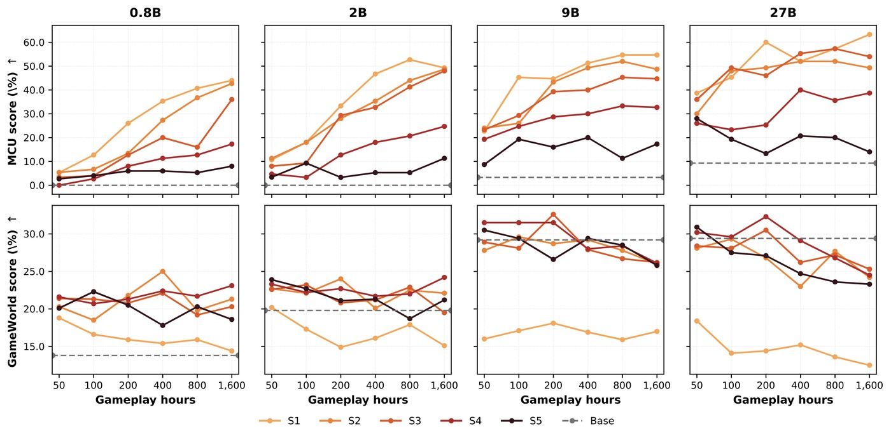
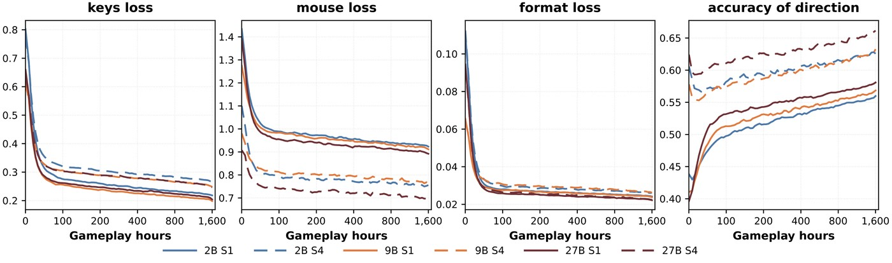
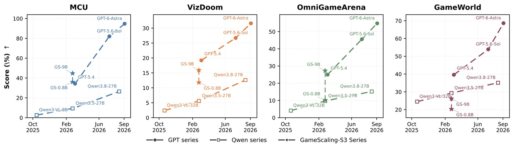
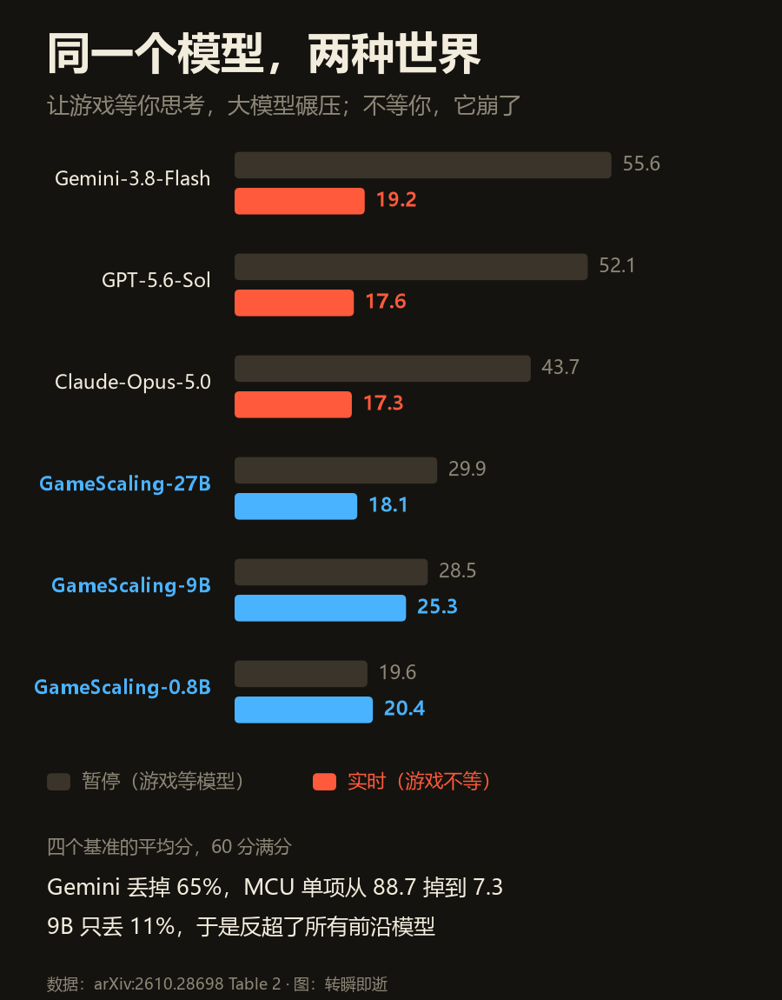
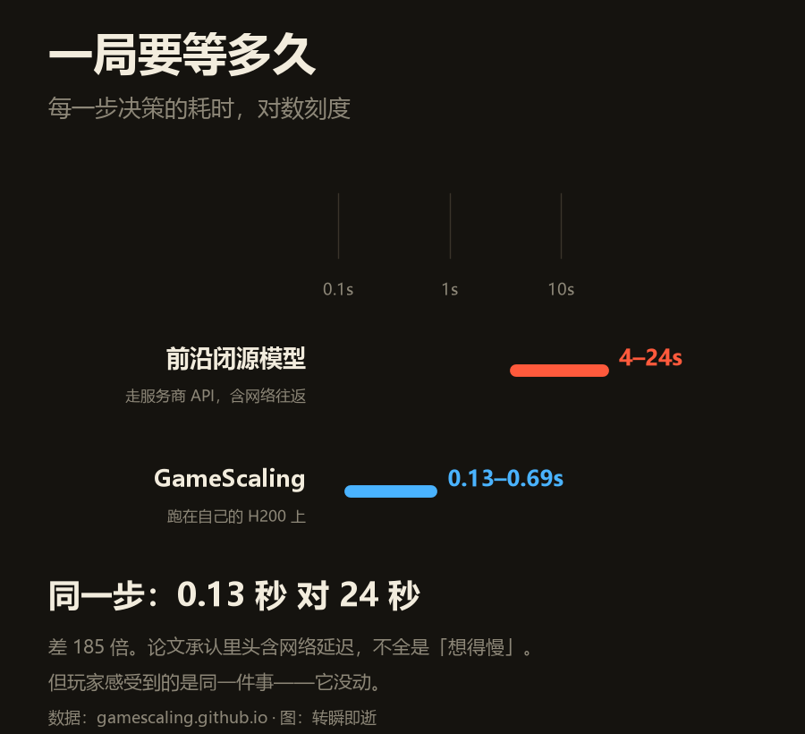
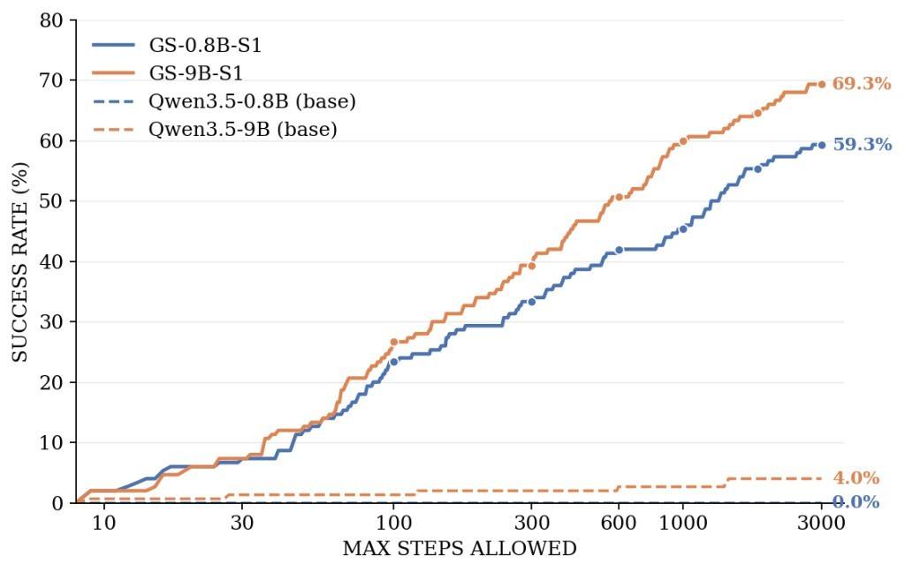

2026 年 10 月 20 日，arXiv 上挂出一篇论文，十一个作者，两个通讯作者邮箱：一个 tsinghua.edu.cn，一个 mihoyo.com。

标题很长：《Scaling in Games: Continued Pre-Training For Embodied Agents In Diverse Virtual Worlds》。

翻成中文大概是：在游戏里做大——让具身智能体在各种各样的虚拟世界里继续预训练。

四家机构：米哈游崩坏 AI 研发团队、清华、国科大、港大，另外还有新国立和北大的人参与。

<figure class="post-fig"><figcaption>论文项目页。四家机构的 logo，米哈游排在第一个；通讯作者一个是 mihoyo.com，一个是 tsinghua.edu.cn。截图：gamescaling.github.io，2026 年 10 月 23 日。</figcaption></figure>

他们干的事，一句话说得完：把同一批模型扔进 80 款游戏，看会发生什么。

规模不小：120 组配置——模型 0.8B 到 27B 四档，语料 50 到 1600 小时六档，混合方案五套，最纯的只喂 Minecraft，最杂的喂满 80 款。总共烧了 2.2×10^22 FLOPs。

然后考四张卷子：MCU 和 ViZDoom（练过的），OmniGameArena（没见过但结构相近的 7 个 3D 世界），GameWorld（没见过也不像的，以 2D、2.5D 为主）。

<figure class="post-fig"><figcaption>论文 Figure 1。左边&quot;一个物理世界&quot;：物理相同、画面相同、控制相同，所以能扩、能泛化。右边&quot;一堆虚拟世界&quot;：赛车、雪山、宝可梦、国际象棋，物理不同、画面不同、控制不同——能扩吗？能泛化吗？整篇论文就在回答这两个问号。（图源：arXiv:2610.28698）</figcaption></figure>

这篇论文最值钱的地方，不是证明了"规模有用"。这个大家早就知道。

是它画出了规模**失效**的那条线。

## 一、三个旋钮，两个有效，一个反噬

先看一张图。取自论文主图，原本四行，我裁掉中间两行，只留对比最强的——上排是练过的 MCU，下排是没见过的 GameWorld。

<figure class="post-fig"><figcaption>论文 Figure 8 的局部（暂停设置下的评测）。上排 MCU，下排 GameWorld；四列是 0.8B、2B、9B、27B，横轴是训练游戏时长（50 到 1600 小时），颜色是五套混合方案，越亮越纯（S1 只喂 Minecraft），越深越杂；灰色虚线是没训过的底座。原图还有 ViZDoom 和 OmniGameArena 两行，为省版面略去。（图源：arXiv:2610.28698，裁切）</figcaption></figure>

先说前两个，因为它们符合直觉，但符合得有限。

数据量往上拧，练过的世界分数往上走——50 小时到 1600 小时，MCU 一路涨。看上排，从左到右就是抬起来的，最纯那条（S1）从个位数爬到 40 分以上。

多样性往上拧，**像的**陌生世界也跟着涨——OmniGameArena 从只玩 Minecraft 到 80 款混训，有明确提升。代价是练过的世界会掉：还是上排，最亮的 S1 压在最上面，越深的颜色越低——混得越杂，MCU 上越吃亏。

但换到 GameWorld，两个旋钮一个彻底失灵、一个只抬了一下就停。

数据从 50 小时堆到 1600 小时，分数横着。下排那几条线，起点在哪终点还在哪。

多样性确实抬了一手：最亮的 S1 一直贴着 15 分走，混得最杂的那几条能摸到 22 到 28 分。但这笔收益是一次性的，抬完就停，而且离上排那 40 多分还差着一大截。

第三个旋钮更麻烦：模型尺寸。

往上拧，学得更快，达到同样分数用的数据更少，这是好事。但论文发现一个反常识的副作用——**只在一个世界里训练时，模型越大，对差别大的世界泛化越差**。

不是"没提升"，是"更差"。

同样用 S3 混合数据，27B 在 GameWorld 上拿 25.3，9B 拿 26.2。

**关你什么事：** 你手上有几百万条自家业务的日志，想训一个什么都能干的 agent。这三个旋钮告诉你它能到什么程度——到"像你的业务"为止，再往外，投入换不回来。

## 二、为什么"多换几款游戏"也没用

论文把训练过程切成两段，这一段是全文最有解释力的地方。

**早期，叫接口期。** 模型在学的是"怎么看屏幕、怎么把手柄输入翻译成动作、抬头看到的是什么"。这一层跨世界通用——不管你玩的是 Minecraft 还是赛车，都是"看懂画面、做出动作"。

证据是损失曲线的形状：键盘、鼠标、格式这三项，头一百小时就断崖式压下去了，之后一千五百小时几乎不动。学完就是学完了。

<figure class="post-fig"><figcaption>论文 Figure 2。四条曲线：键盘损失、鼠标损失、格式损失，和最右边的八方向预测准确率。前三项在头 100 小时里从高处砸下来，之后贴着底走；准确率还在往上爬——能操作是一回事，操作得准是另一回事。（图源：arXiv:2610.28698）</figcaption></figure>

所以相对底座，四个基准都是抬起来的——继续预训练本身有效。但抬多高、抬完还涨不涨，是两回事。

**后期，叫世界期。** 模型在学的是这个世界自己的规律：重力多大、判定多严、什么动作会被惩罚、什么时机该等。

这一层不通用。你在这个世界学到的"跳一下刚好够到台阶"，换个世界就是掉进坑里。

于是"多喂几款游戏"的收益，会在某个点之后突然变平——新世界只是帮它更快走完接口期，走完之后，各学各的。

论文还拟合了一个经验规律，把验证损失写成数据量、多样性和模型规模的函数，用来预测"再投多少能拿到多少"。

**关你什么事：** 你的业务，在别人眼里就是 GameWorld——差别大的那个世界。别人的 agent 迁不过来，跟你拿自己数据练出来的，不是一种东西。这既是坏消息（别指望通用模型开箱即用），也是好消息（你的数据有护城河）。

## 三、真正的反转：游戏不等你

到这里，参数还不算悬殊。真正的分水岭在评测方式上。

先看节奏。论文里的动作是这么切的：每 200 毫秒一帧，每帧看一眼屏幕、出一组键鼠动作。

<figure class="post-fig"><figcaption>论文 Figure 5。《Apex 英雄》里连续五帧，0 到 800 毫秒，每帧间隔 200 毫秒。上面是画面，中间是模型看到的东西，下面是按键和鼠标动作。注意第 2、3、4 帧：`&lt;think&gt;` 里是空的，它什么都没想就出手了——只有第 1 帧和第 5 帧写了推理。（图源：arXiv:2610.28698）</figcaption></figure>

两百毫秒。你眨一次眼大概三百。

论文做了两套设置：

一套叫 **time-paused**：游戏停住，等模型想完再动。这套考的是纯粹的能力。

一套叫 **real-time**：游戏不停，模型在想的时候，世界还在往前走。这套考的是能力加反应速度。

暂停设置下，前沿模型是碾压的。Gemini-3.8-Flash 四个基准平均 55.6 分，GPT-5.6-Sol 52.1，Claude-Opus-5.0 43.7。米哈游最好的 27B，只有 29.9。

<figure class="post-fig"><figcaption>论文 Figure 6。暂停设置下，四个基准各自的分数与模型发布时间。圆圈是 GPT 系列，方块是 Qwen 系列，星号是 GameScaling 的 9B。最右那张 GameWorld 上，9B 的星号（约 21 分）落在 Qwen3-8-27B 方块（约 38 分）下面，离 GPT-5.6-Sol 的 55 分更远。这一格得看清楚：不暂停的时候，它是输的。（图源：arXiv:2610.28698）</figcaption></figure>

实时设置下，全塌了。

<figure class="post-fig"><figcaption>我自己画的，数据来自论文 Table 2。灰条是暂停设置，彩条是实时设置。最上面那三条大模型，一换到实时就断了一大截；下面 0.8B 到 9B 那条几乎没动。</figcaption></figure>

Gemini 平均从 55.6 掉到 19.2，掉了 65%。单项更惨：MCU 从 88.7 掉到 7.3，掉了 92%。

9B 的 GameScaling 从 28.5 掉到 25.3，只掉 11%。

于是 25.3 对 19.2，赢了 6.1 分。连 0.8B 那个都有 20.4，比所有闭源模型都高。

论文的原话是：**"延迟的决策，会在一个已经变了的世界上执行。"**

它还给了一组更直观的数：实时下，前沿模型只能保住暂停成绩的 35%，0.8B 到 9B 这几档能保住 88%。

<figure class="post-fig"><figcaption>我自己画的，数据来自论文 Table 9。横轴是同一步决策的耗时，对数刻度。四条大模型落在 4 到 24 秒之间，四条开源小模型落在 0.13 到 0.69 秒之间。</figcaption></figure>

最慢的一步 24 秒，最快的一步 0.13 秒——185 倍。

这里必须补一句诚实的话，因为论文自己也写了：前沿模型走的是服务商的 API，这条链上有网络往返；GameScaling 跑在自己的 H200 上。所以不全是"脑子慢"，很大一部分是"链路慢"。

但这不改变结论。因为对用户来说，这就是同一件事——**它没动**。

**关你什么事：** 你要的从来不是"最聪明的模型"，是"在你这个世界的节奏里来得及的模型"。客服 3 秒不回，人就走了；交易 200 毫秒没成交，价格已经变了；车里 100 毫秒，是一米八。

## 四、这篇论文真正在说：这条路走到头了

先把话说清楚：它没有说"小模型比大模型强"。

它说的是，**继续预训练（CPT）这条路，在远离训练分布的地方，边际收益已经耗尽**。

论文自己列了证据：

27B 在 GameWorld 上不如 9B；数据从 50 小时堆到 1600 小时，远处那列几乎没动；多喂 80 款游戏，远处的提升依然有限。

测试时扩展能补一部分——9B 把搜索步数从 600 加到 3000，MCU 成功率从 50.9% 拉到 69.3%。

<figure class="post-fig"><figcaption>论文 Figure 9。横轴是允许的最大步数（对数刻度），纵轴是 MCU 上 30 个任务的累计成功率。实线是训过的 GameScaling，虚线是没训过的底座。两条虚线贴着零走——底座一点都不会玩，是继续预训练把它教会了；实线一路爬到 69.3%。（图源：arXiv:2610.28698）</figcaption></figure>

但那是在用延迟换分数，在实时世界里正好是自杀。600 步是这个协议的默认值，3000 步意味着想五倍久——在 200 毫秒一帧的世界里，等于站着不动。

所以作者最后一句结论写得很克制：要做出通用的具身智能体，需要"比继续预训练更丰富的训练阶段"。

翻译成人话：喂更多数据、更多游戏、更大的模型，这三招都到顶了。下一步得换方法，不是换规模。

**关你什么事：** 如果你的团队还在用"再堆点数据试试"回答所有问题，这篇论文就是那个"不用试了"的答案。省下来的钱，够请几个人把评测做扎实。

今日新闻烟火记录完毕

愿你的模型，在该快的时候快得起来。
