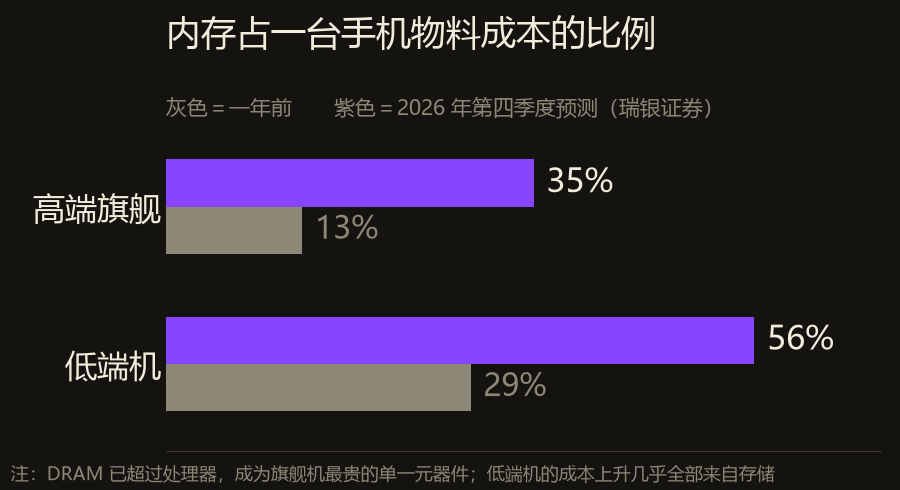
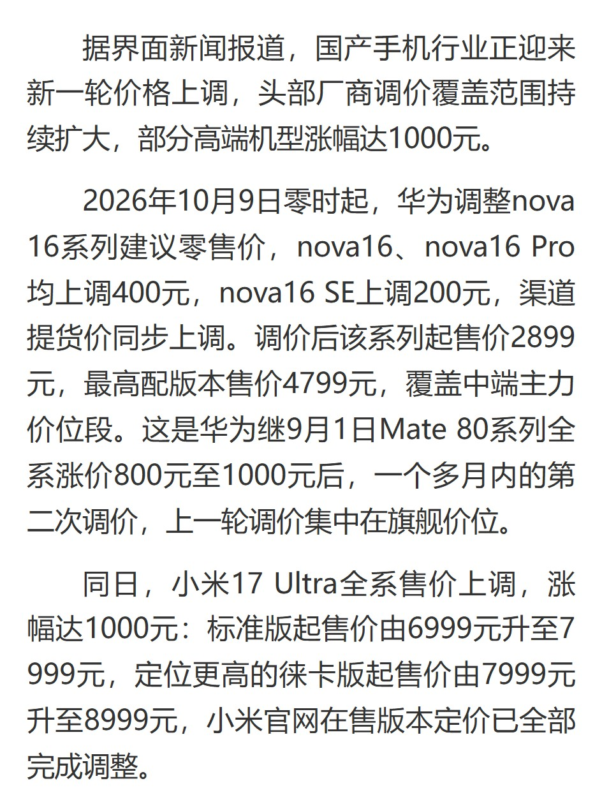
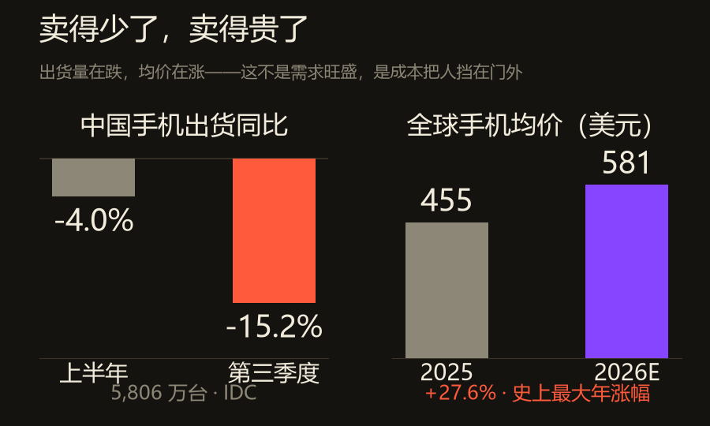
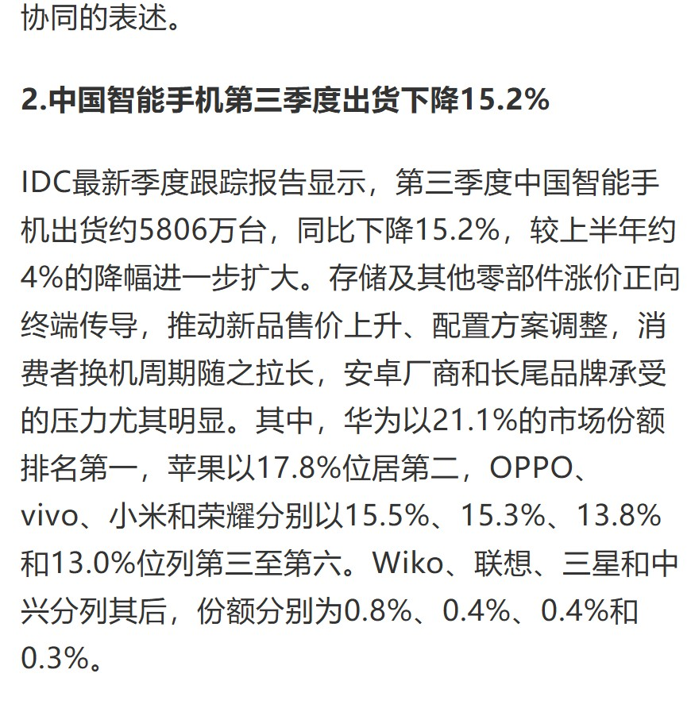
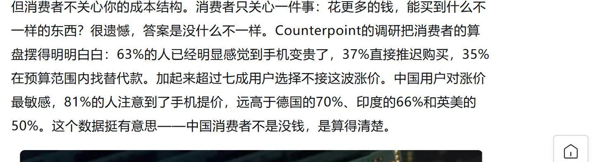
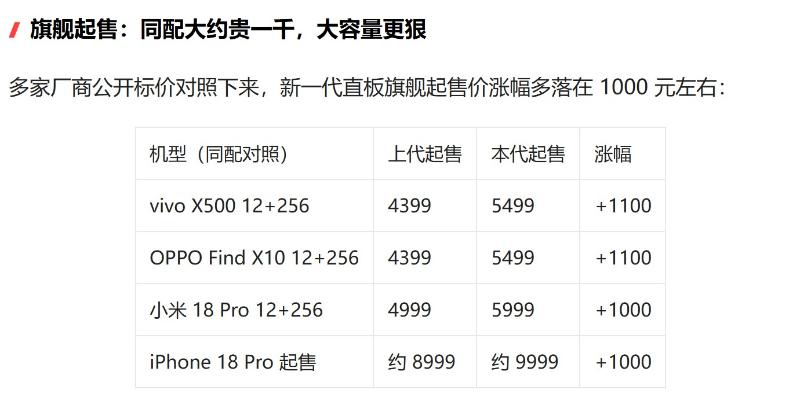
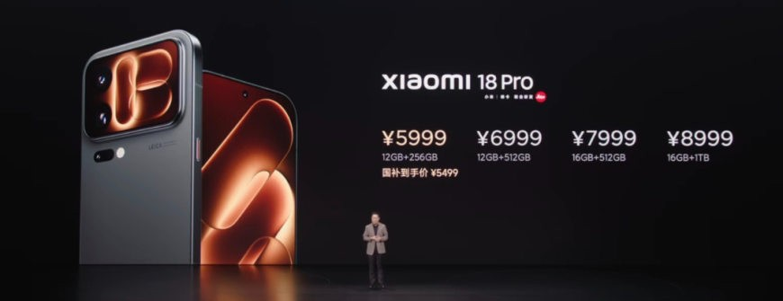

2026 年 10 月 9 日零时，华为调整 nova16 系列价格：nova16 与 nova16 Pro 各涨 400 元，nova16 SE 涨 200 元。

同一天，小米 17 Ultra 全系涨 1000 元。标准版从 6999 到 7999，徕卡版从 7999 到 8999。

这是今年国产手机的**第四轮**集中涨价。3 月 OPPO 打第一枪，8 月小米跟进，9 月 1 日华为 Mate 80 全系涨 800 到 1000，10 月这一轮，涨价的重心从旗舰下探到了 2899 元起的中端主力。

厂商不是突然贪了。是他们手里那张成本表，换了样子。

## 一、一台手机里最贵的零件，换了人

过去的手机，处理器是最贵的单一元器件。现在不是了。

2026 年第二季度，手机内存价格环比涨超 80%。DRAM 已经超过 SoC，成为旗舰机物料成本里最贵的一项。

瑞银证券的测算更具体：到 2026 年第四季度，内存将占高端旗舰手机物料成本的 35%，占低端手机的 56%。一年前，这两个数字分别是 13% 和 29%。

<figure class="post-fig"><figcaption>内存占手机物料成本的比例。灰色是一年前，紫色是 2026 年第四季度的预测。低端机从 29% 涨到 56%——这个档位的成本上升，几乎全部来自存储。数据：瑞银证券，图为本刊整理。</figcaption></figure>

一个零件从 13% 涨到 35%，中间那 22 个百分点，是从别的地方挪出来的：屏幕、影像、结构件，或者利润。

低端机更没有腾挪空间。29% 到 56%，涨了将近一倍，而一台千元机的整机利润本来就只有几十块。

余承东在 9 月 29 日的国际媒体圆桌会议上说得很直白：

"我们以非常缓慢的速度涨价，因为我们试图自己承担成本，这样消费者就不必承担这些成本。但说实话，我们的整体利润率正在急剧下降。展望未来，我们也不得不提高价格。如果我们遭受损失，我们的业务将无法持续。"

他在另一个场合给出的数字是：新机的内存成本上涨超过 2000 元。

而 10 月 9 日 nova16 涨的是 400 元。

也就是说，价签上补回来的，只有供应链账单的五分之一。

<figure class="post-fig"><figcaption>华为 nova16 系列与小米 17 Ultra 同日调价。注意两个细节：nova16 涨 400 元，是华为一个多月内的第二次调价；小米 17 Ultra 涨 1000 元，标准版从 6999 到 7999。截图：中华网科技（引界面新闻），2026 年 10 月 9 日。</figcaption></figure>

高通中国区董事长孟樸有句话，被引用得很多：从业几十年，没见过存储一年涨四五倍。

TrendForce 的数据支撑这个说法：服务器 DRAM 合约价 2025 年下半年累计涨约 64%，2026 年预计再涨约 270%。

一年 64%，下一年 270%。这个斜率不像大宗商品，像某种被抢购的东西。

## 二、抢的人不是手机厂

2026 年，全球 AI 服务器出货量同比增长约 180%。

AI 服务器占全球存储总需求的比例，已经达到 **53%**。

换句话说，全世界生产出来的存储芯片，一半以上没有进手机、没有进电脑，进了数据中心。

存储原厂的选择很好理解：HBM 和服务器 DRAM 的毛利远高于手机用的 LPDDR。同样一片晶圆，切成给 AI 的，能卖更贵。

于是消费级存储被虹吸。

10 月 27 日，SK 海力士发布三季度财报：销售额 104.62 万亿韩元，市场预期 98.96 万亿；营业利润 83.33 万亿韩元，预期 77.5 万亿。同时宣布回购 20 万亿韩元股票。

财报里最值得记的一句话，不是这些数字。

是这句：**内存供应短缺将持续至 2030 年**。

同一周，台积电被曝拟将 CoWoS 先进封装报价上调 10% 到 20%。CoWoS 是把逻辑芯片和高带宽内存封在一起的技术，AI 芯片绕不过去。台积电的月产能 2026 年底预计突破 13 万片，2027 年 20 万片以上——而摩根士丹利算的 2027 年全球需求是 269.4 万片。

还有一件事更说明问题：阿里巴巴、腾讯、字节等中国云厂商，正在与三星、SK 海力士洽谈服务器 DDR 与 LPDDR 的长期供货协议，部分客户希望把期限延长到 **2035 年**。行业常见的合约期是三到五年。

十年长约是什么意思？是把未来十年的内存价格提前锁死。

手机厂签不了这种合同。它们的采购量按季度算，议价能力按机型算，一款机器卖不动，下一季的订单就没了。

所以在这条链上，手机厂排第二。云厂商排第一，而且已经在为 2035 年付定金。

<figure class="post-fig"><figcaption>卖得少了，卖得贵了。左边是中国手机出货的同比，右边是全球手机均价。这两根线在过去一年里第一次朝相反方向走。数据：IDC，图为本刊整理。</figcaption></figure>

## 三、账单最后落在换手机的人身上

先看两组数字，它们的方向是反的。

中国：第三季度智能手机出货约 5806 万台，同比下降 **15.2%**。上半年的降幅是 4%——一个季度里，跌幅扩大了将近四倍。

全球：2026 年智能手机平均售价预计 581 美元，比 2025 年的 455 美元涨 **27.6%**，创下有史以来最大的年度涨幅。

IDC 副总裁王吉平对这件事的定性是："ASP 的急剧攀升并非需求拉动，而是成本驱动的被动涨价。"

卖得少，卖得贵。这不是旺盛，这是收缩。

<figure class="post-fig"><figcaption>IDC 的季度跟踪报告原文。除了 -15.2%，还有一份份额表：华为 21.1% 第一，苹果 17.8% 第二，OPPO、vivo、小米、荣耀分列三到六位。截图：腾讯新闻·观网硬科技早报（引 IDC），2026 年 10 月 28 日。</figcaption></figure>

消费者的反应，比任何分析都直接。

Counterpoint 的调研：63% 的人已经明显感觉到手机变贵，37% 直接推迟购买，35% 在预算范围内找替代款。三项加起来，超过七成人选择不接这波涨价。

中国用户最敏感：81% 的人注意到了手机提价，高于德国的 70%、印度的 66%、英美的 50%。

<figure class="post-fig"><figcaption>Counterpoint 的调研数据。63% 觉得贵了，37% 推迟购买，35% 找替代款；中国用户注意到涨价的比例是 81%，明显高于其他市场。截图：腾讯新闻，2026 年 10 月 14 日。</figcaption></figure>

还有一个数字更直观：国内用户平均换机周期已经拉长到 40 个月以上，接近三年半。早年是两年一换。

68.5% 的人，要等手机损坏、卡顿、电池老化才换。

厂商在做什么？

不是硬涨。是拆。

vivo 新增 Pro Max 超大杯，把 16GB 内存集中在高配机型上消化；标准版和 Pro 只给 12GB。OPPO Find X10 拉出三档价格梯度，X10 E 起售 4999，标准版 5499，Pro Max 6799。荣耀新增"超能版"，用低价位段承接压力。iQOO 则把多个存储档位压进一台机型，简化供应链。

所有动作指向同一件事：**把贵的部分集中到愿意付钱的人身上，把便宜的入口留得更低。**

再用国补、以旧换新、首发权益，把用户实际掏的钱压回去一点。

<figure class="post-fig"><figcaption>新一代直板旗舰的起售价对照。vivo X500 和 OPPO Find X10 各涨 1100 元，小米 18 Pro 和 iPhone 18 Pro 各涨 1000 元。同配对照，一个不漏。截图：今日头条，2026 年 10 月 9 日。</figcaption></figure>

这就是为什么发布会的价签上，总要多写一行小字。

小米 18 Pro 12+256 标价 5999 元，底下跟着"国补到手价 ¥5499"。

涨的是成本，补的是心理落差。中间那 500 元，是补贴替用户扛的。

<figure class="post-fig"><figcaption>小米 18 Pro 发布会价格页。四档 5999 到 8999，12+256 那行底下写着&quot;国补到手价 ¥5499&quot;。涨价这件事，厂商和补贴在分摊。图源：小米发布会截图，2026 年 9 月。</figcaption></figure>

关你什么事： 如果你打算一年内换机，先看清楚一件事——现在这台机器的价格里，有一部分是你在替 AI 公司付内存的钱。同一档配置，去年买和今年买，差价基本就是那根内存条的涨幅。真要换，挑大容量机型最不划算，那是成本涨得最狠的一档。

## 最后

这条链能追溯到一个很朴素的排序：

AI 出得起价，手机出不起。

同样一片 DRAM 晶圆，卖给数据中心能收到几倍的钱，卖给手机厂只能收到一半。存储原厂不是在做道德选择，是在做利润选择。SK 海力士说得客气一点，叫"根据客户需求、产品竞争力、盈利能力及投资效率，灵活调整投资规模和时机"。

翻译过来：谁给的钱多，产能给谁。

手机是第一个被挤出产能的消费品。

不会是最后一个。

PC 的 DDR5 已经在涨，汽车座舱的存储成本在被重新算，SSD 的价格曲线跟着 NAND 走同一条路。任何需要"几个 GB 内存"的东西，都在和 AI 抢同一批晶圆。

而 AI 的需求还没有见顶。马斯克说，机器人对内存的消耗将超过地球上现有的所有计算设备。如果这句话成立，2030 年不是终点，只是中途。

所以短期内别指望降价。

一台手机的成本表上，第一次出现了一个不属于手机的变量。

今日新闻烟火记录完毕

愿你要换的那台机器，价格在你决定之前先降下来。
